---

title: "线性电路分析：可视化课堂"

author: "Artice M. Davis"

source: "Linear Circuit Analysis"

---

# 把电路， 看成会呼吸的系统

## 00 · 数学工具箱：公式背后的六件事

*先补直觉，再碰公式*

电路里的公式，其实只用到几样数学：直线、斜率、面积、指数、复数、方程。先把它们变成“看得见的图”，公式就不再是符号堆。

#### ① 直线：y = kx + b

k 是斜率，意思是“横着走一格，竖着升多少”。b 是截距，意思是“起点在哪”。

电阻的电压—电流关系就是一条过原点的直线：斜率就是电阻。斜率越大，同样的电流需要越高电压。

$$
v = R i
$$

#### ② 导数：曲线在某点的“陡不陡”

导数就是切线斜率，也就是“变化率”。电压变化得越快，电容电流越大；电流变化得越快，电感电压越大。

$$
\begin{aligned}i = C \cdot \frac{dv}{dt}\\v = L \cdot \frac{di}{dt}\end{aligned}
$$

#### ③ 积分：把无数小条“加起来”

积分就是曲线下的面积。电流一点点流，电荷就一点点攒；功率一点点给，能量就一点点攒。

$$
\begin{aligned}q(t) = \int i dt\\w(t) = \int p dt\end{aligned}
$$

#### ④ 指数：变化率和“自己”成正比

$e^{at}$ 求导还是 $e^{at}$ 乘 a。a 为负就衰减，a 为正就发散。RC 充电、RL 电流、一阶响应，全是这条曲线。

$$
\begin{aligned}d(e^{at})/dt = a e^{at}\\v = V(1 - e^{-\frac{t}{τ}})\end{aligned}
$$

#### ⑤ 复数：长度 + 角度

j² = −1。一个复数可以看成平面上的箭头：长度是幅度，角度是相位。乘 j 就是逆时针转 90°。相量就是“会转的复数”。

$$
z = x + jy = |z|\angle θ
$$

#### ⑥ 微分方程：把“变化率”写成方程

一阶方程 y′ + ay = x 的解里一定带 $e^{−at}$。a 的符号决定衰减还是发散；二阶方程则多出一对“阻尼 + 振荡”。

$$
y(t) = y_{\infty } + (y_{0} - y_{\infty })e^{-at}
$$

### 把“斜率”和“面积”画出来

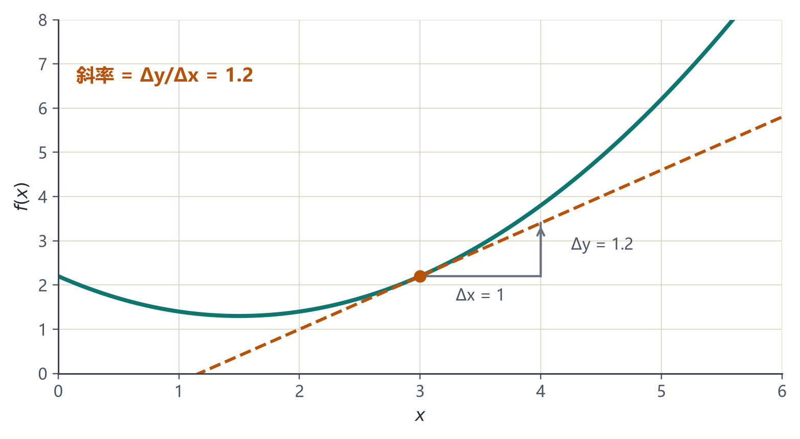

*导数 = 切线斜率 = 瞬时变化率*

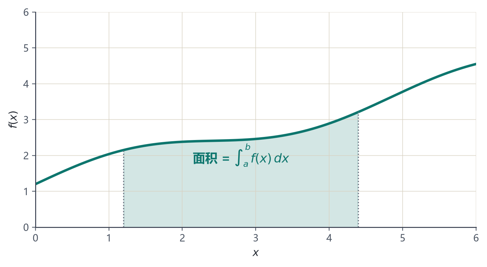

*积分 = 面积 = 累积量*

### 把“旋转”和“衰减”画出来

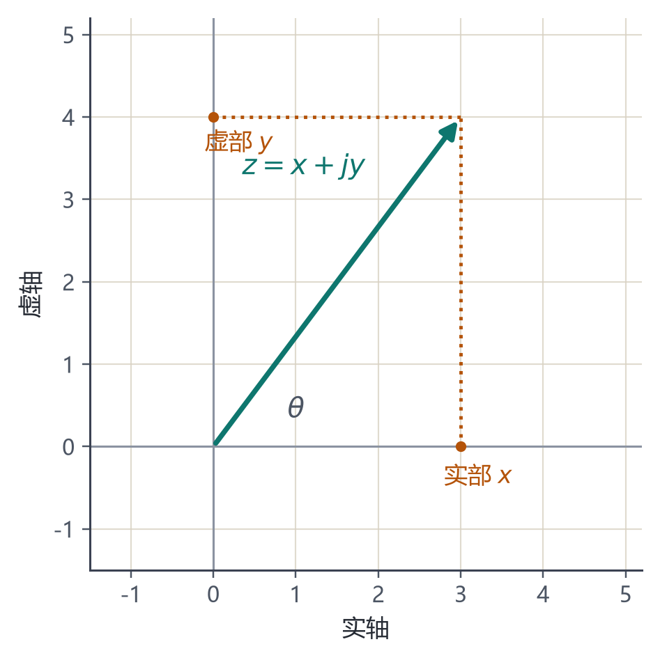

*复数 = 长度 + 角度；相量 = 会旋转的复数*

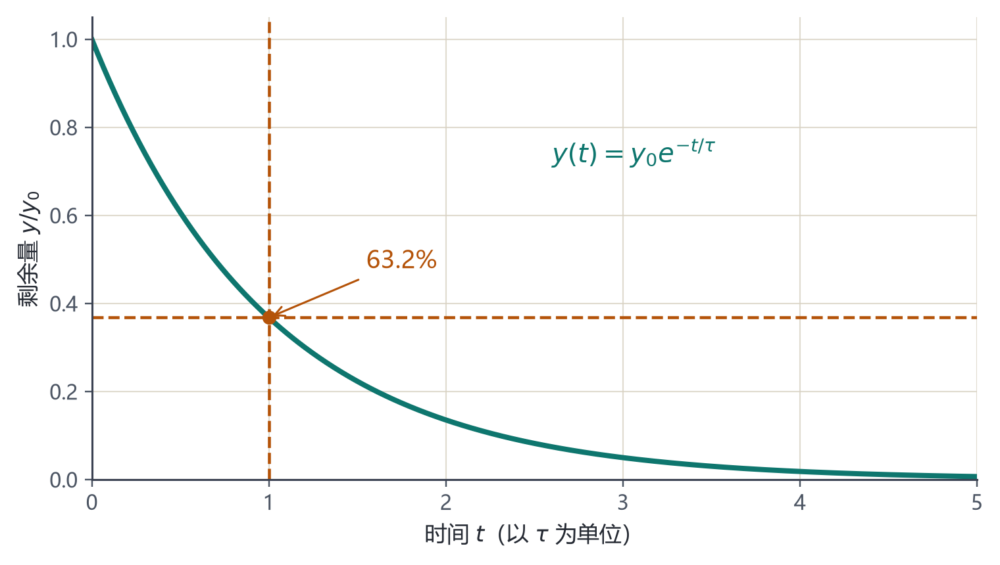

*指数衰减：变化率与剩余量成正比*

### 还有两件小工具：矩阵与对数

**矩阵**只是“把联立方程排整齐”。节点法、网孔法列到最后，都是 Ax = b。行列式不为零，才有唯一解；Cramer 法则就是“用行列式相除”解出每个未知量。

$$
\begin{aligned}A x = b\\x_{i} = det(A_{i}) / det(A)\end{aligned}
$$

**对数**把乘法变成加法：log(ab) = log a + log b。Bode 图正是利用这一点——串联环节的增益相乘，在对数坐标里变成斜率相加。

$$
\begin{aligned}A_{dB} = 20 log_{10}|H|\\log(ab) = \log a + \log b\end{aligned}
$$

① 它说的是“直线”还是“曲线”？  

        ② 它是在“求变化率”还是在“求累积”？  

        ③ 它是“时域”的话，能不能换到频域或 s 域，把微积分变成代数？

这三问能解决电路里八成公式的“来历”问题。

> **一句话记住**公式只是五块积木：直线、斜率、面积、指数、复数。

## 01 · 先把电想成水

*建立直觉 · 不写公式*

电路里的东西看不见摸不着。最好的入门办法，是先找一套“水管”来类比；等直觉长出来，再换回电的语言。

电压像水位差，电流像水流量，电阻像细管子，电容像水罐，电感像水轮，电源像水泵，地像海平面。电路图就是一张水管图：线是管子，元件是管子上的器件，节点是接头。

#### 电压 = 水位差

两点之间的“高度差”。高度差越大，推动水流的力量越大。

#### 电流 = 流量

每秒钟流过多少水。它“穿过”导体，不是“跨在”两点上。

#### 电阻 = 细管

管子越细，同样的水压下水流量越小；电阻越大，电流越小。

#### 电容 = 水罐

能存水，水位不能瞬间改变；对应电容电压不能跳变。

#### 电感 = 飞轮

有惯性，水流不能瞬间改变；对应电感电流不能跳变。

#### 地 = 海平面

只是选定的零高度，不是“把电路埋进土里”的安全接地。

图可以拉长、弯曲、重画，只要“谁和谁相接”不变，电路的行为就不变。这个“只认连接关系”的性质，叫**拓扑**。

> **先记住：**电压表要跨着量，电流表要串着量；表笔或表夹反接，读数变号，这不是故障，只是实际方向和你规定的方向相反。

### 再深入一点：电压和电流到底是怎么“定义”的

本书不先假设“电压是什么”，而是规定一套操作：用电压表跨接两点，红笔接“＋”、黑笔接另一点，读数由数值、单位、符号三部分组成。换一下表笔，符号就反过来——这就是参考方向。

双下标 **$v_{ab}$** 里，第一个字母带“＋”，第二个带“－”，所以交换下标必须变号。节点电压则是把黑笔固定在参考点，红笔逐点去量；换一个参考点，所有节点电压整体平移，但两点之间的电压差不变。

电荷和磁链是“累积量”：电流积成电荷，电压积成磁链。它们都带初始值，这正是后面“初始条件”的来源。

$$
\begin{aligned}v_{ab} = - v_{ba}\\q(t) = q_{0} + \int _{0}^{t} i dτ\\λ(t) = λ_{0} + \int _{0}^{t} v dτ\end{aligned}
$$

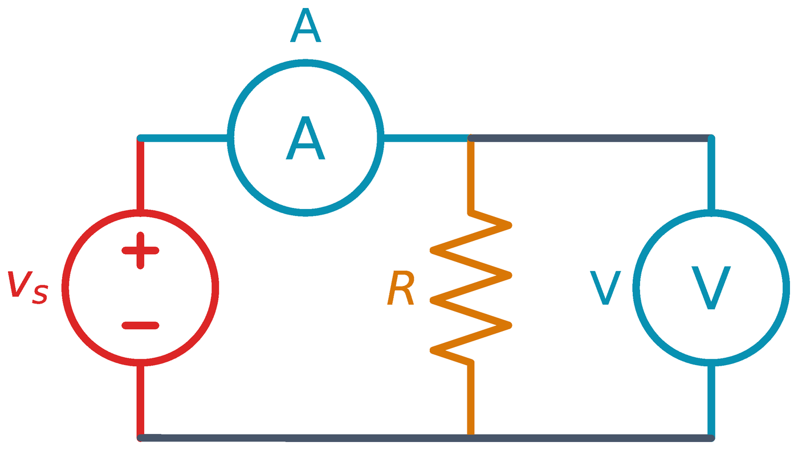

*电压“跨着量”，电流“串着量”；表笔反接只改变符号*

> 🔌
> 现实里：手机充电器
> 充电器把墙上的 220 V 交流变成 5 V 直流，靠的就是“电压变换 + 整流 + 滤波”。你摸到的“5 V”是两点之间的高度差，不是“电子有多快”。

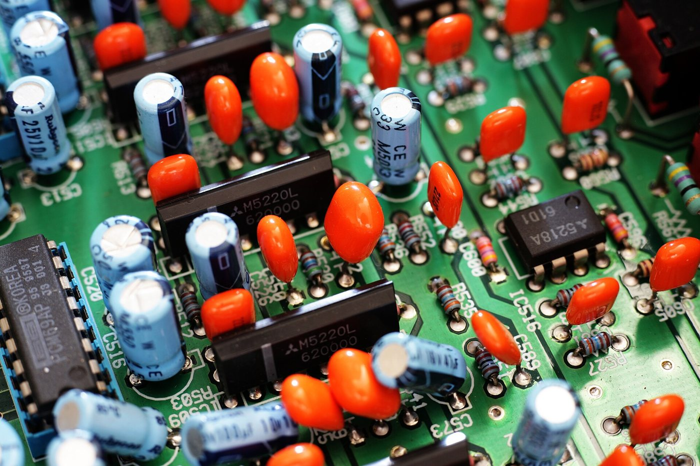

*一块真实电路板：元件、铜箔与过孔把电路变成一张网络。 [图源：Ashley Pomeroy / CC BY 4.0](https://commons.wikimedia.org/wiki/File:Printed_Circuit_Board_9990.jpg)*

> **一句话记住**电压是高度差，电流是流量，地只是海平面。

*脉络上游：测量与单位→本节→下游：端口与功率*

## 02 · 三个基本量：电压、电流、时间

*测量 · 参考方向 · 功率*

电路里所有的量，最后都能追到三个“可以直接测量”的基本量。其余都是它们乘出来、积出来的。

- **电压**：两点之间的高度差。双下标 **$v_{ab}$** 表示 a 比 b 高，交换下标就变号。

- **电流**：穿过导体的流量。箭头是人为规定的正方向，反接读数变号。

- **时间**：一切“变化快慢”的标尺。电容、电感之所以有“记忆”，就是因为它们对时间累积。

选一个节点当 0 V（参考点），其他节点相对它的电压就是**节点电压**。换一个参考点，所有节点电压整体平移，但任意两点之间的电压差不变。

### 功率：元件是在“吃”还是在“吐”

按关联方向（电流从电压的“＋”端流入）算，功率等于电压乘电流。结果是正，元件在吸收；结果是负，元件在发出。

能量就是功率随时间的累积。只吸收、不发出的叫无源元件；能够对外供能的叫有源元件。

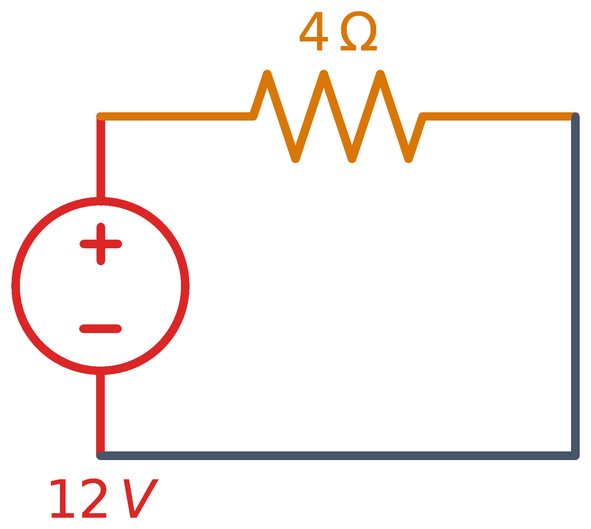

*同一股水流：电池把水抽上去，电阻把水放下来*

> **别踩坑：**把“地”当成安全接地；把负读数当成元件坏了；忘记参考方向，导致功率符号全反。

### 再深入一点：功率的四种符号组合

在关联方向下 **p = vi**。电压、电流各自可正可负，于是有四种组合；真正决定“吸收还是发出”的，只是乘积的符号，而不是电压或电流单独的正负。

| v | i | $p = vi$ | 含义 |
|---|---|---|---|
| ＋ | ＋ | ＋ | 吸收 |
| ＋ | － | － | 发出 |
| － | ＋ | － | 发出 |
| － | － | ＋ | 吸收 |

无源元件要求对一切时刻都有 **w(t) ≥ 0**；有源元件只要求“能找到某一时刻 w < 0”，也就是它有能力净输出能量。电池放电时在发出，接上充电器时在吸收，但它仍然是有源元件。

$$
\begin{aligned}p(t) = v(t) i(t)\\w(t) = \int _{-\infty }^{t} p dτ = w_{0} + \int _{0}^{t} p dτ\end{aligned}
$$

> **互动 · 二端元件的功率符号**

> 点按钮翻转电压极性或电流方向。看 p = vi 什么时候是吸收，什么时候是发出。

> 💡
> 现实里：电费单
> 电费按“度”算，1 度 = 1 kWh = 1000 W 用 1 小时。功率乘时间就是能量；所以 100 W 的灯亮 10 小时，和 1000 W 的空调开 1 小时，电费一样。

*USB 充电头：把交流 220 V 变成直流 5 V，内部同样离不开变压器与滤波电容。 [图源：Raimond Spekking / CC BY-SA 4.0](https://commons.wikimedia.org/wiki/File:USB_power_adapter_for_Apple_iPod,_Model_A1205,_by_Foxlink_Technology_Ltd-1048.jpg)*

> **一句话记住**功率看乘积的符号，能量看时间的累积。

*脉络上游：参考方向→本节→下游：电阻与独立源*

## 03 · 两条铁律：KCL 与 KVL

*连接强加的约束*

元件有元件自己的脾气（电压电流关系），连接方式又强加了两条铁律。两者合起来，电路就“可解”了。

> **互动 · KCL 节点**

> 两条支路电流可调，第三条自动补齐。看节点从不“积水”。

> **互动 · KVL 绕行**

> 探针沿回路走一圈，路过高亮元件并累加电压；回到起点总和为零。

**KCL** 说的是电荷不会在节点上堆积；对任意画一个包围面也同样成立。**KVL** 说的是绕任意闭合回路走一圈，电压上升的总和等于下降的总和；由此还能得到“两点电压与路径无关”。

为什么这两条就够？因为未知量是每条支路的电压和电流，而元件关系给一半方程，KCL 和 KVL 给另一半。N 个节点只有 N−1 条独立 KCL，B 条支路只有 B−N+1 条独立 KVL。

> **别踩坑：**先画方向再列式；符号错一次，后面全错。另外，这套理论假设“尺寸无关、磁通不变”，频率极高或电路极大时会失效。

### 再深入一点：KCL 的“包围面”与方程的数目

KCL 不只对一个节点成立，对任意画出的封闭面也成立：穿进这个面的电流总和，等于穿出它的电流总和。这个面可以包住好几个节点，甚至包住半个电路。

KVL 也有“路径形式”：从同一点出发、沿两条不同路径走到另一点，两条路径上的电压升之和相等。由此得到“两点电压与路径无关”，绕回路一周则升降相抵。

方程够不够？N 个节点只有 N−1 条独立 KCL；B 条支路只有 B−N+1 条独立 KVL。再加上每条支路自己的元件关系，正好凑齐 2B 个方程、2B 个未知量。

$$
\begin{aligned}\sum i_{\text{出}} = 0\\\sum v_{\text{降}} = 0\\N-1 \text{条} KCL\\B-N+1 \text{条} KVL\end{aligned}
$$

> **互动 · KCL 包围面**

> 拖动三条支路电流，第四条自动补齐。无论包围面画多大，流入总等于流出。

### 补遗：四条公理与适用边界

整本书的推导，最后都落在四条不加证明的假设上：

- **只通过端子打交道**：元件之间除了端子电压、电流，没有别的“隔空”影响。

- **尺寸与方向无关**：元件多大、怎么摆，都不影响行为。

- **KCL**：电荷不会在节点上堆积。

- **KVL**：回路里没有随时间变化的磁通。

这四条在低频、小尺寸下非常好用；频率高到波长与电路尺寸可比，或者电路大到一个城市那么大，就必须换成“分布参数/传输线”的语言。公理 3 也意味着这套理论不处理静电积累——那是另一门课的事。

> 🏠
> 现实里：家里的插座
> 墙上的插座是并联的：每个电器都拿到 220 V，互不影响。开关和灯是串联的：开关断开，电流无路可走。配电箱里的各路电流，最后都要满足 KCL。

> **一句话记住**路口不积水（KCL），绕山一圈回原点（KVL）。

*脉络上游：端口 v-i→本节→下游：等效与方程*

## 04 · 等效与戴维南：把黑箱压成一个电池

*化繁为简的核心手艺*

两个子电路，只要端口上的电压—电流关系完全一样，对外就可以互换。等效只保证“对外一样”，内部可以完全不同。

- **串联**：一条路走到底，电流相同，电压按电阻大小分。

- **并联**：接在同一对节点上，电压相同，电流按电导（电阻的倒数）分。

- **电源变换**：电压源串电阻，可以换装成电流源并同一个电阻，反过来也行。

- **叠加**：每个独立源单独开工，其他源“下班”（电压源短路、电流源开路），结果相加。

**戴维南定理**说：任何线性二端网络，对外都能压成“一个电压源串一个电阻”。电压源是端口开路时量到的电压，电阻是内部独立源全部下班后从端口看进去的电阻。内部有受控源时，不能简单下班，要外加一个测试源去“问”。

> **互动 · 最大功率**

> 固定黑箱：开路电压 12 V，内阻 4 Ω。拖动负载，看它拿到多少功率。

### 为什么内阻等于负载时功率最大？

负载太小，电压几乎全落在内阻上；负载太大，电流又太小。两头都不讨好，中间有一个“甜点”。

这个甜点就是负载等于内阻。但此时内阻上也消耗同样多的功率，效率只有一半——“最大功率”不等于“最高效率”。

$$
P_{L} = V_{oc}^{2} \cdot \frac{R_{L}}{(R_{eq} + R_{L})^{2}}
$$

拖动左边的滑块，曲线上的圆点会跟着走。

> **别踩坑：**用等效电路去算原电路内部的功率——等效只对外成立；求戴维南电阻时把受控源也“下班”了——受控源必须保留；用叠加算功率——功率不能叠加。

### 再深入一点：电源变换、戴维南与诺顿是一家人

一个电压源串电阻，可以换装成一个电流源并同一个电阻，条件是 **$v_{s}$ = R $i_{s}$**，并且电流源的箭头要指向电压源的“＋”端。反过来也成立。

戴维南把任意线性二端网络压成“电压源串电阻”：**v = $v_{oc}$ + $R_{eq}$ i**。诺顿则压成“电流源并电阻”：**i = v/$R_{eq}$ − $i_{sc}$**，其中 $i_{sc}$ = $v_{oc}$/$R_{eq}$。求 $R_{eq}$ 时独立源置零，但受控源必须保留；有受控源时用外加测试源去“问”。

负载等于内阻时功率最大：$P_{max}$ = $v_{oc}$²/($4R_{eq}$)，但效率只有一半。置换定理、电源搬移，都是“保持端子关系不变”的拓扑手术。

$$
\begin{aligned}v_{s} = R i_{s}\\v = v_{oc} + R_{eq}i\\i_{sc} = \frac{v_{oc}}{R_{eq}}\end{aligned}
$$

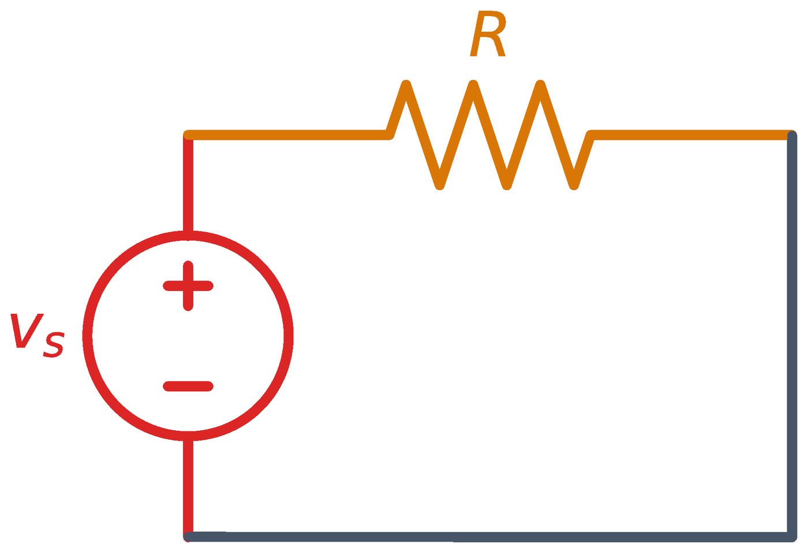

*两种电源模型可以互换；任何线性黑箱都能压成戴维南或诺顿*

### 再补一张图：串联、并联与分压分流

串联是“一条路走到底”：两个电阻流过同一电流，电压按阻值正比分配。阻值越大，分到的电压越多；总电阻直接相加。

并联是“接在同一对节点上”：两个电阻承受同一电压，电流按电导正比分配。阻值越小，分到的电流越多；总电导直接相加。

分压、分流是电路分析里最常用的两个“心算工具”。但要记住：分压公式只在串联、且没有其他支路“分流”时成立；一旦接上负载，原来的分压比就被拉偏了。

$$
\begin{aligned}R_{eq} = R_{1} + R_{2}\\v_{2} = \frac{R_{2}}{(R_{1}+R_{2})} \cdot v\\G_{eq} = G_{1} + G_{2}\\i_{1} = \frac{R_{2}}{(R_{1}+R_{2})} \cdot i\end{aligned}
$$

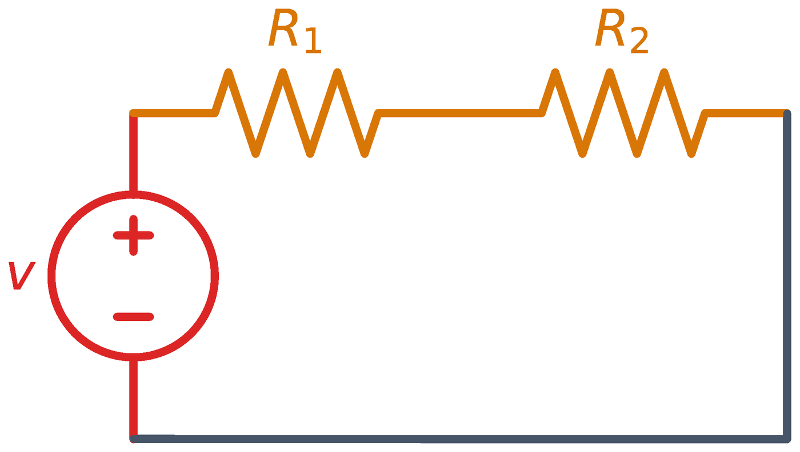

*串联分压、并联分流：一个看“同一电流”，一个看“同一电压”*

### 补遗：叠加、置换与电源搬移

- **叠加**：每个独立源单独作用，其余电压源短路、电流源开路；受控源不能“下班”。叠加只对电压、电流成立，功率不行，因为功率是平方关系。

- **置换定理**：已知某条支路的电压，就可以把它换成一个同值电压源；已知电流，就换成同值电流源。前提是电路有唯一解。

- **电源搬移**：电压源可以沿节点“搬家”，电流源可以换到同一对节点之间的另一条路径上，只要搬完之后各端子的电压电流关系不变。

这三件事的共同点：都在“保持端口关系不变”的前提下做拓扑手术。做之前先问一句——我改的是外部关系，还是内部结构？

### 推导 · 分压公式从哪来

$$
v = v_{1} + v_{2}
$$

$$
v_{1} = R_{1}i\quad \quad v_{2} = R_{2}i
$$

$$
v = (R_{1} + R_{2})i\quad \Rightarrow \quad i = \frac{v}{(R_{1} + R_{2})}
$$

$$
v_{2} = R_{2}i = \frac{R_{2}}{(R_{1} + R_{2})} \cdot v
$$

所以“分压”不是新定律，只是 KVL + 欧姆定律 + “同一电流”三件事合起来的结果。

### 推导 · 戴维南为什么总能压成“电池 + 电阻”

$$
v = (\text{内部源单独作用时的电压}) + (i \text{单独作用时的电压})
$$

$$
v = v_{oc} + R_{eq} i
$$

这就是戴维南定理：不是“近似”，而是线性叠加的必然结果。诺顿只是把同一式子两边除以 $R_{eq}$。

> 🎚️
> 现实里：音量电位器与传感器
> 音量旋钮就是一个分压器：把输入信号分出一部分送给放大器。热敏电阻、光敏电阻也常接成分压器，把“温度/亮度”变成“电压”再送进芯片。

*色环电阻：二端元件，伏安特性是一条过原点的直线。 Three.js 3D 渲染*

> **一句话记住**对外一样就能换；戴维南就是“电池 + 电阻”。

*脉络上游：欧姆定律→本节→下游：节点与网孔*

## 05 · 节点法与网孔法：让方程自己长出来

*两个万能算法*

前面的等效靠“看图找结构”，不是每个电路都长得那么乖。节点法和网孔法是两个“必定能列方程”的通用办法。

1. 选一个节点当参考点（0 V）。

2. 对其余每个节点写一条 KCL：流出的电流之和为零。

3. 每条支路电流用两端节点电压之差表示。

4. 解方程，得到各节点电压，再求其他量。

电压源夹在两个非参考节点之间时，把这两个节点打包成**超节点**：对包围面写一条 KCL，再补一条“两节点电压差等于电源电压”。电压源一端接地时，那个节点的电压直接已知。

1. 确认电路是平面电路（能画在纸上、导线不交叉）。

2. 给每个“窗格”设一个顺时针的网孔电流。

3. 绕每个窗格写 KVL。

4. 解出网孔电流，再求支路电流和电压。

网孔电流是假想的环流，但每条支路电流都能用它表示；KCL 会自动满足，所以只需要 KVL。电流源夹在两个网孔之间时，合成**超网孔**：绕外圈写 KVL，再补一条电流约束。

> **互动 · 节点电压与网孔环流**

> 在上方切换“节点法 / 网孔法”。拖动电源和 R₂，看方程与解怎么变。

### 怎么选？

节点少，用节点法；网孔少，用网孔法。含电流源多，节点法省事；含电压源多，网孔法省事。

含受控源时，先把它当独立源列方程，列完再“撕开”，把控制量代回去。矩阵不再对称，这是有源电路的特征。

> **别踩坑：**单位要配套，kΩ 配 mA 配 V；电压源省节点方程，电流源省网孔方程，别记反。

### 再深入一点：超节点、超网孔与“观察法”

电压源夹在两个非参考节点之间，这两个节点的电压差被固定了。把它们打包成一个**超节点**：对包围面写一条 KCL，再补一条“两个节点电压之差等于电源电压”。电压源一端接地时，那个节点电压直接已知，连方程都不用写。

电流源夹在两个网孔之间，合成**超网孔**：绕外圈写一条 KVL，再补一条“两个网孔电流之差等于电流源电流”。

方程有固定的“形状”：节点矩阵对角是接在该节点的电导之和，非对角是负的互电导；网孔矩阵完全对偶。这就是观察法。含受控源时先贴住、列方程、再撕开，矩阵会失去对称。

$$
\begin{aligned}\text{节点：}G v = i\\G_{ii} = \sum G\\G_{ij} = -\sum G_{ij}\\（\text{网孔对偶）}\end{aligned}
$$

> **互动 · 超节点：打包与拆开**

> 电压源夹在两个节点之间。点按钮把两个节点“打包”，看方程怎么少一条。

> 🧮
> 现实里：电路仿真软件
> SPICE 这类软件内部做的事，就是替你列节点方程、解矩阵。你画的每一根线，最后都变成 Gv = i 里的一行。学会节点法，就看懂了仿真器的“心脏”。

### 再深入一点：节点方程与网孔方程是“数”出来的

**节点法思路：**选参考点，未知量是节点电压；对每个非参考节点写 KCL，支路电流用 ($V_{i}$ − $V_{j}$)/R 表示。

$$
\begin{aligned}(V_{1}-V_{s})/R_{1} + \frac{V_{1}}{R_{2}} + (V_{1}-V_{2})/R_{3} = 0\\(V_{2}-V_{1})/R_{3} + \frac{V_{2}}{R_{4}} = 0\end{aligned}
$$

按 $V_{1}$、$V_{2}$ 合并同类项，就得到矩阵：

$$
\begin{aligned}(\frac{1}{R_{1}}+\frac{1}{R_{2}}+\frac{1}{R_{3}})V_{1} - (\frac{1}{R_{3}})V_{2} = \frac{V_{s}}{R_{1}}\\-(\frac{1}{R_{3}})V_{1} + (\frac{1}{R_{3}}+\frac{1}{R_{4}})V_{2} = 0\end{aligned}
$$

这就是 Gv = i：对角线是接在该节点的电导之和，非对角线是负的互电导。

**网孔法思路：**未知量是网孔电流；对每个网孔写 KVL，公共支路的电流是两个网孔电流之差。

$$
\begin{aligned}(R_{1}+R_{2})i_{1} - R_{2}i_{2} = V_{s}\\-R_{2}i_{1} + (R_{2}+R_{3}+R_{4})i_{2} = 0\end{aligned}
$$

写成 Zi = v：对角线是网孔自阻，非对角线是互阻的负值。

**对偶：**节点法数“流出的电流”，网孔法数“绕圈的电压”；G ↔ R，v ↔ i，KCL ↔ KVL。

> **一句话记住**节点数电流，网孔数电压；电压源包超节点，电流源包超网孔。

*脉络上游：KCL / KVL→本节→下游：受控源与动态*

## 06 · 受控源与运放：会“听指挥”的元件

*有源电路的开端*

独立源自己说了算；受控源听别处的电压或电流指挥。它让电路第一次有了“放大”和“负电阻”这些本事。

- **VCVS**：电压控制电压源，系数是无量纲的电压增益。

- **VCCS**：电压控制电流源，系数是跨导。

- **CCVS**：电流控制电压源，系数是转移电阻。

- **CCCS**：电流控制电流源，系数是电流增益。

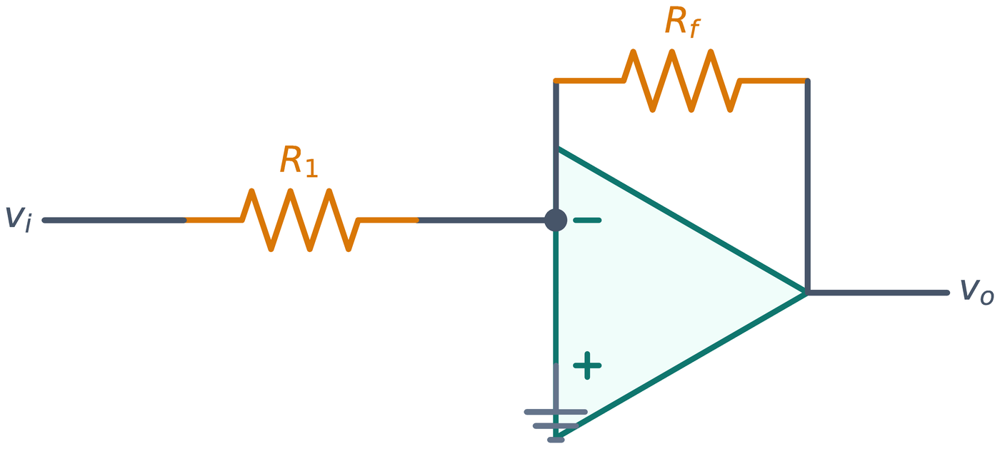

*反相放大：输入经 $R_{in}$ 接反相端，$R_{f}$ 从输出接回反相端*

> **互动 · 反相放大器**

> 输入固定 1 V。拖动两个电阻，看增益和输出怎么变。

**虚短与虚断：**理想运放增益无穷大，加上负反馈后，两个输入端电压几乎相等（虚短），且几乎不取电流（虚断）。反相放大时，反相端几乎是 0 V，叫“虚地”。

**反馈：**把输出送回输入端。负反馈用增益换带宽、线性度和阻抗；正反馈太强会自激。判断稳定要看环路增益：绕一圈既不衰减、相位又转满一圈，就会振荡。

**二极管与三极管：**本质非线性。工程上的办法是“小信号”：在直流工作点画一条切线，把曲线当直线，再用线性电路的方法分析变化量。

> **别踩坑：**虚短只在负反馈、输出未饱和时成立；开环比较器或输出撞到电源轨，就不能再用虚短。

### 再深入一点：四种受控源与“贴住—撕开”

受控源有四种：电压控制电压源（VCVS，系数 μ 无量纲）、电压控制电流源（VCCS，系数 $g_{m}$ 是跨导）、电流控制电压源（CCVS，系数 $r_{m}$ 是转移电阻）、电流控制电流源（CCCS，系数 β 是电流增益）。

分析时先把受控源“贴住”，当成独立源列方程；列完再“撕开”，把它的值用控制量替换，控制量用节点电压或网孔电流表示，代回去解。含受控源时矩阵不再对称，这是有源电路的标志。

受控源还能造出**负电阻**：让 CCVS 的控制量取自身端电流，得到 v = −2i，端口功率 p = −2i² 恒为负，确实在向外供能。它不是永动机，只是有源电路在小信号下的等效。

运放是“增益无穷大的 VCVS”。有限增益时 $v_{o}$ = μ($v_{+}$ − $v_{−}$)；μ → ∞ 且负反馈时，$v_{+}$ = $v_{−}$（虚短），输入端不取电流（虚断）。

$$
\begin{aligned}v_{c} = μ v_{x}\\i_{c} = g_{m} v_{x}\\v_{c} = r_{m} i_{x}\\i_{c} = β i_{x}\end{aligned}
$$

> **互动 · 四种受控源**

> 切换类型，拖动增益。受控源的输出永远跟着控制量走。

### 再补一张图：积分器与微分器

把反相放大器的输入电阻换成电容，就成了**积分器**：输入电流给电容充电，输出与输入的积分成正比。它的 s 域增益是 −1/(sRC)，在频域里是一条 −20 dB/十倍频的斜线，相位恒为 90°。

把反馈电阻换成电容、输入保留电阻，就成了**微分器**：输出与输入的变化率成正比，s 域增益是 −sRC，频域斜率 +20 dB/十倍频。

积分器会“记”住历史，常用于滤波、控制和模拟计算；微分器会放大高频噪声，实际电路里往往要串一个小电阻限制高频增益。

$$
\begin{aligned}\text{积分器：}H(s) = -\frac{1}{(sRC)}\\v_{o} = -(\frac{1}{RC})\int v_{i}dt\\\text{微分器：}H(s) = -sRC\\v_{o} = -RC \frac{dv_{i}}{dt}\end{aligned}
$$

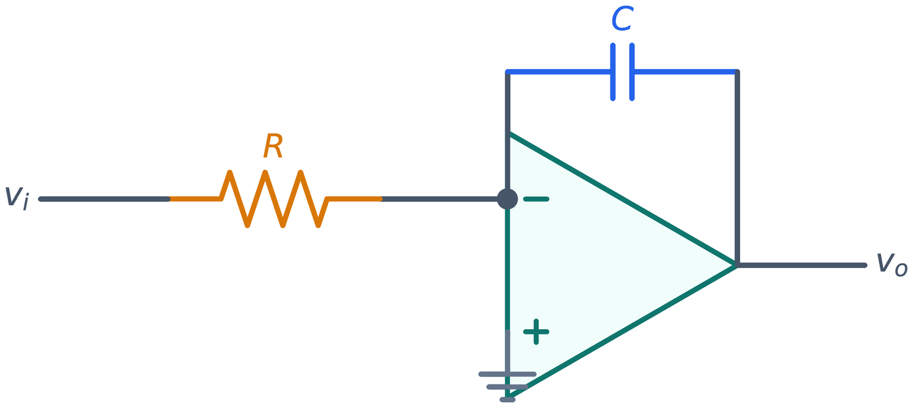

*电容放在输入是积分，放在反馈是微分*

### 推导 · 反相放大器的增益

$$
(v_{i} - 0)/R_{in} = (0 - v_{o})/R_{f}
$$

$$
\frac{v_{o}}{v_{i}} = - \frac{R_{f}}{R_{in}}
$$

负号来自“电流流进虚地再流出去”的方向；增益大小只由两个电阻之比决定，和运放本身的开环增益几乎无关——这正是负反馈的魔力。

> 🎤
> 现实里：麦克风前置放大
> 麦克风输出的信号只有几毫伏，必须先放大再处理。反相/同相放大器就是最常用的“第一级”。虚短让增益只取决于电阻，温度、批次差异都被反馈“压住”了。

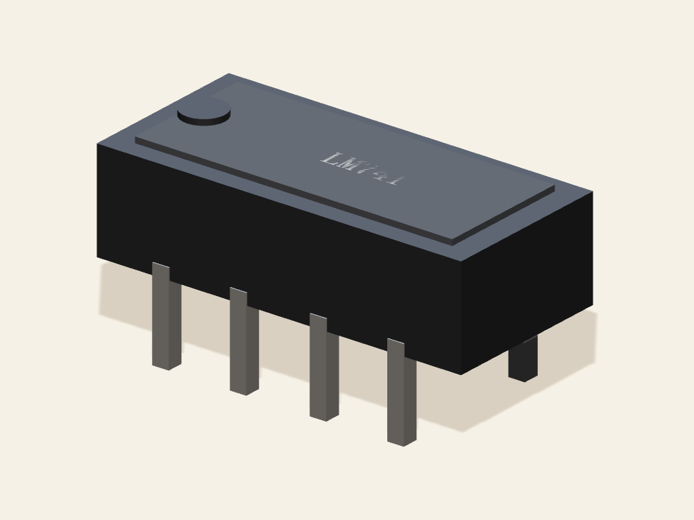

*LM741 运放：八脚双列直插，对外只表现为虚短、虚断。 Three.js 3D 渲染*

> **一句话记住**受控源听指挥，运放把“指挥”推到无穷大。

*脉络上游：受控源→本节→下游：有源滤波与稳定*

## 07 · 电容与电感：电路的“记忆”

*储能 · 连续性 · 换路*

电阻是“现在”的元件，电压电流随时成正比；电容和电感会“记住”过去，因为它们把能量存了起来。

#### 电容：储水罐

存电荷，电荷 = 电容 × 电压。电流 = 电容 × 电压变化率。

电压变化越快，电流越大；电压不变（直流稳态），电流为零，相当于**开路**。

只要电流有限，电容电压**不能瞬间跳变**。能量储在电场里。

#### 电感：飞轮

存磁链，磁链 = 电感 × 电流。电压 = 电感 × 电流变化率。

电流变化越快，电压越大；电流不变（直流稳态），电压为零，相当于**短路**。

只要电压有限，电感电流**不能瞬间跳变**。能量储在磁场里。

**换路：**开关动作的一瞬间，电路分成“动作前”和“动作后”。先用动作前的电路求电容电压、电感电流（它们不能跳），再把电容换成同值电压源、电感换成同值电流源，去解动作后的电路。这个“替代”动作，就是常说的 0⁻ 到 0⁺。

> **别踩坑：**电容电压连续，但电容电流可以跳；电感电流连续，但电感电压可以跳。连续的是“状态量”，不是所有量。

### 再深入一点：电容与电感的“对偶”

电容的“状态量”是电压：q = Cv，i = C dv/dt。只要电流有限，电压就不能跳；直流稳态时电流为零，电容相当于开路。能量储在电场里。

$$
w_{C} = \tfrac{1}{2}Cv^{2}
$$

电感的“状态量”是电流：λ = Li，v = L di/dt。只要电压有限，电流就不能跳；直流稳态时电压为零，电感相当于短路。能量储在磁场里。

$$
w_{L} = \tfrac{1}{2}Li^{2}
$$

串并联的规律正好“反过来”：电容像电导一样相加（并联相加），电感像电阻一样相加（串联相加）。突然把两个电容并联、或把电感支路断开，会出现冲激，状态量会跳变。

$$
\begin{aligned}i = C \frac{dv}{dt}\\v = L \frac{di}{dt}\end{aligned}
$$

> **互动 · 电容像水桶，电感像飞轮**

> 电容存电荷，电压不能跳；电感存磁通，电流不能跳。切换看看。

### 补遗：串并联、直流稳态与相容单位

- **电容**：并联相加（像电导），串联取倒数和；分压时大电容分到小电压。

- **电感**：串联相加（像电阻），并联取倒数和；分流时大电感分到小电流。

- **直流稳态**：电容开路、电感短路；但“短路”上的电流、“开路”上的电压由外电路决定，不能凭空分配。

- **相容单位**：kΩ 配 mA 配 V，μF 配 μs，MΩ 配 μA。配套之后数字直接相乘，少写一堆 10 的幂。

两个并联电感被电流源驱动时，直流等效只给出“总电流”，分配要靠磁链相等（λ₁ = λ₂）或“缓慢升流”的极限来定；两个串联电容被隔离时，电荷相等（q₁ = q₂）。这类“奇异稳态”是考试里最容易漏的地方。

### 推导：½Cv² 和 ½Li² 的“½”从哪来

**思路：**功率是能量对时间的导数，p = vi；把元件的 v-i 关系代进去，对时间积分即可。

$$
w_{C} = \int p dt = \int v\cdot C(\frac{dv}{dt})dt = \int C v dv = \tfrac{1}{2}Cv^{2}
$$

这里用了换元 dv = (dv/dt)dt。图形上，v 从 0 升到 V 时，三角形面积就是 ½CV²。

电感同理：

$$
w_{L} = \int v i dt = \int L(\frac{di}{dt})i dt = \int L i di = \tfrac{1}{2}Li^{2}
$$

“½”不是魔法，是三角形面积；能量存进电场或磁场，撤掉源以后还能放出来。

> 📷
> 现实里：闪光灯与继电器
> 相机闪光灯先把电荷慢慢存进大电容，再瞬间放出，得到很强的闪光。继电器线圈是电感，断电瞬间电流想继续流，会在触点间打出火花——这就是“电感反峰电压”。

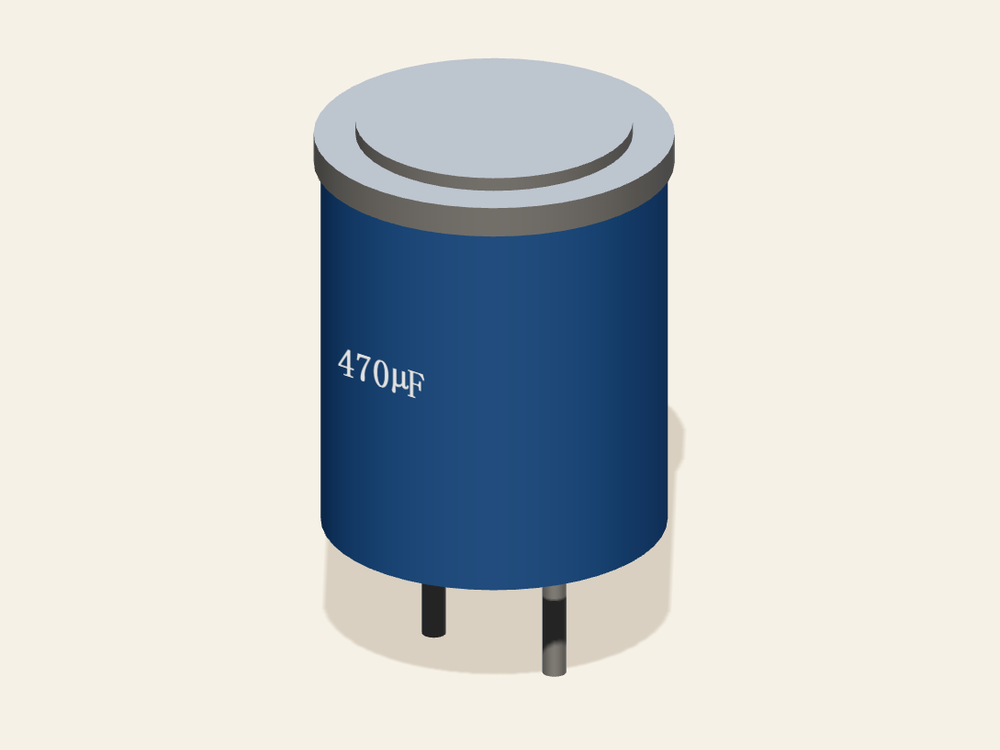

*铝电解电容：容量大，常用来滤波与储能。 Three.js 3D 渲染*

*环形电感：导线绕在磁环上，把能量存进磁场。 Three.js 3D 渲染*

> **一句话记住**电容记电压，电感记电流；连续的是状态量。

*脉络上游：v-i 与积分→本节→下游：一阶与二阶*

## 08 · 一阶电路：指数式地靠近

*时间常数 · 三要素*

只含一个储能元件的电路，响应通常按指数规律靠近终值。它不会“嗖”地到位，而是越靠近越慢。

> **互动 · RC 充电**

> 5 V 电源给电容充电。拖动电阻和电容，看曲线怎么“变胖”。

### 三要素法

一阶电路只要知道三样东西，就能直接写答案：

1. **初值**：换路后一瞬间的值，用 0⁺ 电路求。

2. **终值**：时间足够长以后的值，电容开路、电感短路。

3. **时间常数**：从储能元件两端看出去的等效电阻，配上 C 或 L。

响应 = 终值 +（初值 − 终值）× 衰减指数。

$$
v(t) = V_{\infty } + (V_{0} - V_{\infty }) e^{-\frac{t}{τ}}
$$

经过一个 τ，走完约 63%；经过五个 τ，基本到位。

**低通与高通：**同一个 RC 电路，从电容看是低通（低频过、高频挡），从电阻看是高通（直流挡、跳变过）。截止频率是增益降到 0.707 倍的地方。

> **别踩坑：**时间常数要用“从储能元件看出去”的等效电阻，不是随便挑一个；初值要用 0⁺ 电路，不能用 0⁻ 的电路直接算其他量。

### 再深入一点：低通、高通与“三要素”

RC 低通取电容电压：H(jω) = 1/(1 + jωRC)，截止频率 $ω_{c}$ = 1/RC。过了截止点，频率每升高十倍，增益下降 20 dB。RC 高通取电阻电压：H(jω) = jωRC/(1 + jωRC)，低频被挡住。

更一般的一阶方程是 (p + a)y = (bp + c)x，极点 −a 决定时间常数 τ = 1/a，零点只改变波形的“配比”。

三要素：初值 y(0⁺)、终值 y(∞)、时间常数 τ。把三者代入指数式，就是全响应。τ 要用“从储能元件看出去”的等效电阻来算。

$$
\begin{aligned}H(jω) = \frac{1}{(1 + jωRC)}\\ω_{c} = \frac{1}{RC}\\y(t) = y(\infty ) + [y(0^{+}) - y(\infty )]e^{-\frac{t}{τ}}\end{aligned}
$$

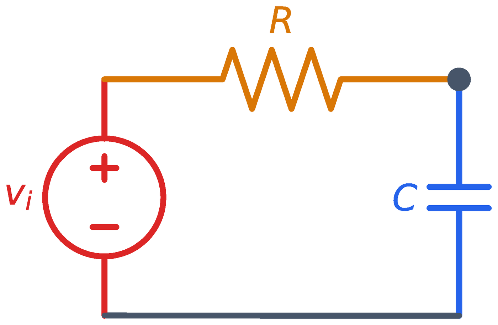

*同一个 RC，从电容看是低通，从电阻看是高通*

### 再补一张图：RL 电路与“飞轮”

RL 电路和 RC 是“对偶”的：电容记电压，电感记电流；RC 的时间常数是 RC，RL 的时间常数是 L/R。

开关合上，电感电流从零慢慢爬向终值；开关断开，电感为了维持电流，会在两端产生很高的反向电压——这就是继电器、点火线圈和“关断过电压”的来源。

直流稳态时电感相当于短路，电流由外电路决定；分析换路时，电感电流不能跳，要用它作为 0⁺ 电路的初始条件。

$$
\begin{aligned}τ = \frac{L}{R}\\i(t) = i(\infty ) + [i(0^{+}) - i(\infty )]e^{-\frac{t}{τ}}\\v_{L} = L \frac{di}{dt}\end{aligned}
$$

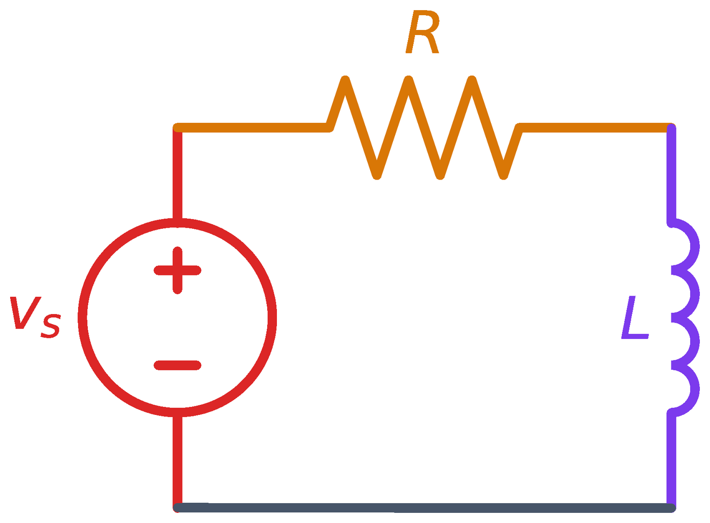

*电感像飞轮：电流想维持原样，强行断开就会“顶”出高压*

### 补遗：一般一阶、有源一阶与真实元件

- **一般一阶**：(p + a)y = (bp + c)x。分母的根 −a 定时间常数，分子的零点只改“直通”和“配比”。

- **有源一阶**：受控源参数进入分母，可能让 a 变号：a > 0 稳定，a = 0 临界，a < 0 发散。

- **仿真图**：用积分器、加法器、比例器搭方程；尽量不用微分器，因为它放大高频噪声。

- **真实元件**：电容有漏电阻，电感有绕线电阻，电阻有寄生电容。模型只在关心的频率、时间尺度内“够用”。

一阶电路的“快慢”全写在 τ 里；而 τ 只由电路自身参数决定，和输入大小无关。这是它最好用的地方。

### 推导 · RC 充电曲线是怎么解出来的

$$
C \frac{dv}{dt} + (v - V_{s})/R = 0
$$

$$
\frac{dv}{dt} + \frac{v}{(RC)} = \frac{V_{s}}{(RC)}
$$

$$
v(t) = V_{s} + A e^{-\frac{t}{RC}}
$$

$$
v(t) = V_{s} + (V_{0} - V_{s}) e^{-\frac{t}{RC}}
$$

τ = RC 不是“背下来的”，而是微分方程里指数项的系数；它决定“多快走完 63%”。

> ⏱️
> 现实里：按键去抖与闪光充电
> 机械按键按下时会“抖”出好几个脉冲，常用 RC 低通把它磨平。闪光灯“充多久能闪”也由 RC 时间常数决定：电容越大、电阻越大，等得越久。

> **一句话记住**一阶看三样：初值、终值、时间常数。

*脉络上游：电容与电感→本节→下游：二阶与稳定*

## 09 · 二阶电路：三种“脾气”

*阻尼 · 振铃 · 稳定*

电容想维持电压，电感想维持电流。两个一起上，就会“打架”：有的电路慢慢爬，有的刚好不振荡，有的会冲过头再荡回来。

> **互动 · 阻尼三态**

> 拖动品质因数 Q。Q 越大，阻尼越小，过冲和振铃越明显。

### 三种阻尼

- **过阻尼**：阻尼很大，慢慢爬向终值，不振荡。

- **临界阻尼**：刚好不振荡，是不振荡里最快的。

- **欠阻尼**：冲过终值，来回振荡，慢慢衰减。

Q 越大，阻尼越小，振荡越明显、持续越久；Q = 0.5 时正好临界。

极点决定响应的形状：全在左半平面就稳定；有极点在右半平面，响应会越来越大。

$$
\begin{aligned}ζ = \frac{1}{(2Q)}\\Q = \frac{ω_{0}}{(2α)}\end{aligned}
$$

**高阶电路**可以拆成若干“简单项”之和，每一项对应一个极点；极点定形状，零点只改比例。拆项的方法叫部分分式展开，拆完查表就能回到时间域。

**Routh 算法**：不想解高次方程时，把系数排成表，数第一列变号几次，就知道有几个右半平面根，从而判断稳定。

> **别踩坑：**欠阻尼时实际振荡频率比自然频率略低，不能混用；Q 小于 0.5 根本没有振荡，别硬套振铃公式。

### 再深入一点：二阶的“标准形”

二阶低通的标准形是 H(s) = $ω_{0}$²/(s² + $2ζω_{0}$s + $ω_{0}$²)。ζ 是阻尼比：ζ > 1 过阻尼，ζ = 1 临界，ζ < 1 欠阻尼。

串联 RLC 中，自然频率、阻尼比与 Q 的关系由下面这组公式给出。电阻越大，阻尼越大，振铃越少，但响应越慢。

二阶响应可以拆成两个一阶项（过阻尼）、一个重根项（临界）或一对共轭项（欠阻尼）。极点全在左半平面就稳定；Routh 算法只数第一列变号，就能判断右半平面根有几个。

$$
\begin{aligned}s^2 + 2\zeta\omega_0 s + \omega_0^2 = 0 \\ \omega_0 = \frac{1}{\sqrt{LC}} \\ \zeta = \frac{R}{2}\sqrt{\frac{C}{L}} \\ Q = \frac{\omega_0 L}{R}\end{aligned}
$$

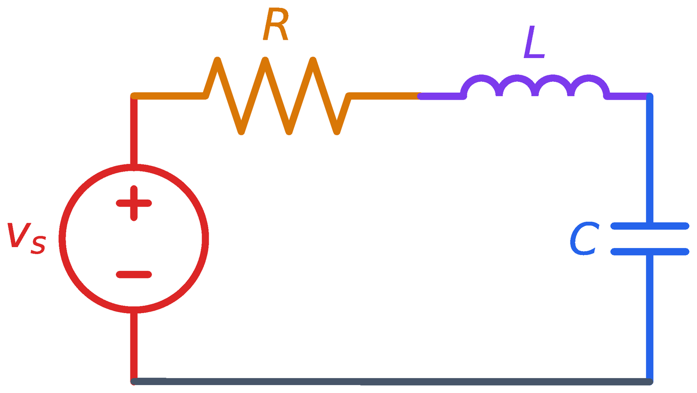

*串联 RLC：电阻定阻尼，LC 定自然频率*

### 补遗：部分分式与 Routh 判稳

- **部分分式**：真分式才能直接拆；分子次数不低于分母时，先做长除。单根用留数（覆盖法），重根要配合求导，共轭复根可合并成“二次分母 + 一次分子”。

- **极点与响应**：实极点给指数，重极点给“t 乘指数”，共轭极点给衰减振荡。零点只改系数，不改“形状”。

- **Routh**：把系数排成表，第一列变号几次，就有几个右半平面根。第一列出现零、或整行为零时，要乘 (s + a) 或用导数行替换。

稳定的判据只看极点，不看零点；临界稳定要求虚轴上的极点都是一阶的。

### 推导 · RLC 的阻尼比从哪来

$$
L \frac{di}{dt} + R i + v_{C} = v_{s}
$$

$$
LC \frac{d^{2}v_{C}}{dt^{2}} + RC \frac{dv_{C}}{dt} + v_{C} = v_{s}
$$

$$
v″ + (\frac{R}{L})v' + (\frac{1}{LC})v = \frac{v_{s}}{(LC)}
$$

$$
\omega_0 = \frac{1}{\sqrt{LC}} \quad 2\zeta\omega_0 = \frac{R}{L} \;\Rightarrow\; \zeta = \frac{R}{2}\sqrt{\frac{C}{L}}
$$

电阻越大，ζ 越大，越不容易振；电感越大、电容越大，ω₀ 越低，振荡越慢。

> 🔊
> 现实里：音箱分频器与汽车悬挂
> 音箱里的 LC 网络把高音、低音分到不同喇叭；设计不好就会在分频点“振铃”。汽车悬挂是同一个二阶方程：弹簧定 ω₀，减震器定 ζ，太软会晃、太硬会颠。

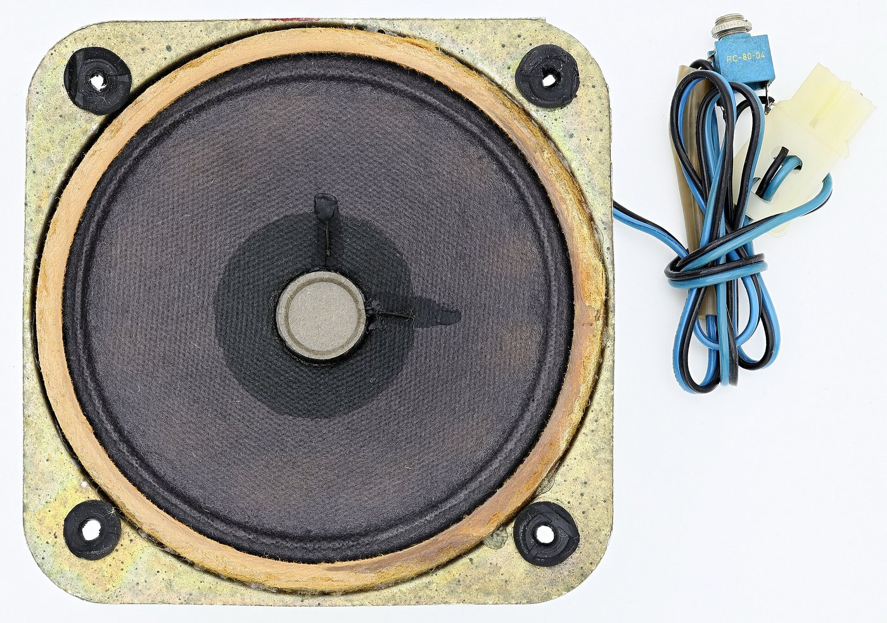

*扬声器：电信号推动振膜，本质是一个机电二阶系统。 [图源：Mister rf / CC BY-SA 4.0](https://commons.wikimedia.org/wiki/File:P21653A_loudspeaker_-_front_view.jpg)*

> **一句话记住**二阶看阻尼：过、临界、欠；Q 越大越振。

*脉络上游：一阶→本节→下游：频响与拉氏*

## 10 · 相量：给正弦拍一张“快照”

*复数 · 阻抗 · 谐振*

第 09 节我们解的是微分方程，关心的是“从换路到稳定”的全过程。可如果激励本来就是正弦，而且我们只关心长期剩下的那部分，还需要每次列微分方程吗？这一节只解决一件事：把正弦稳态变成复数代数。

一个正弦量由**三要素**决定：幅值 $V_{m}$、角频率 ω、初相 θ。频率通常由源决定，所以“求响应”实际只求幅值和相位两个数。

> **先接上一节：**二阶电路的解 = 暂态 + 稳态。暂态由特征根决定，会衰减；稳态由外加正弦决定，频率与源相同。相量法不是另一套电路理论，它只是“求稳态”的捷径。

> **互动 · 旋转的相量**

> 电压固定 10 V，拖动电阻和感抗，看电流相量怎么转、怎么变短。相量图里的长度是幅值，夹角是相位差。

### 先看结论：阻抗是“复数版电阻”

- **电阻**：阻抗是实数 R，电压与电流同相。

- **电感**：阻抗是 jωL，电压超前电流 90°。

- **电容**：阻抗是 1/(jωC)，电压滞后电流 90°。

有了阻抗，欧姆定律、KCL、KVL、节点法、网孔法、戴维南全部照搬，只是实数换成复数。

$$
\begin{aligned}Z_{R} = R\\Z_{L} = jωL\\Z_{C} = \frac{1}{(jωC)}\end{aligned}
$$

**但先别急着记。**下面从“为什么稳态仍是正弦”开始，把这条结论一步步推出来。

### 一、正弦稳态：为什么只看“剩下”的那部分

设线性电路由正弦源驱动：

$$
v_{s}(t) = V_{m} \cos(ωt + θ)
$$

电路里有 R、L、C，列出来是常系数线性微分方程。它的完全解由两部分组成：

$$
\text{完全解} = \text{暂态解} + \text{稳态解}
$$

暂态解是齐次方程的通解，由特征根决定：稳定电路（特征根不在 jω 轴上）里它一定衰减。稳态解是特解，由外加源“逼”出来。关键问题是：这个特解长什么样？

**思路：先猜形式，再代回验证。**因为方程是线性的、源是频率 ω 的正弦，猜特解也是同频正弦，只是幅值和相位待定：

$$
v_{p}(t) = A \cos(ωt + φ)
$$

把它代回微分方程。求导只会把 cos 变成 sin、再变回 cos，频率始终是 ω；方程两边同频，比较 cos 和 sin 的系数，就能解出 A 和 φ。线性方程的特解唯一，所以这就是稳态解。

> **结论**正弦激励下，线性电路的稳态响应仍是同频正弦；频率已知，只剩幅值和相位两个未知量。

这就是相量法能成立的根本原因：我们不需要求整个时间函数，只需要求两个数——幅值 A 和相位 φ。

### 二、把正弦装进复指数：相量的定义

直接比较 cos 和 sin 的系数很啰嗦。欧拉公式给了一个更省事的容器：

$$
e^{jθ} = \cos θ + j \sin θ
$$

于是余弦可以写成复指数的实部：

$$
\cos(ωt + θ) = \operatorname{Re}\left\{ e^{j(ωt+θ)} \right\} = \operatorname{Re}\left\{ e^{jθ} e^{jωt} \right\}
$$

把与时间无关的部分单独拎出来，定义**相量**：

$$
\begin{aligned}V = V_{m} e^{jθ}\\v(t) = \operatorname{Re}\left\{ V e^{jωt} \right\}\end{aligned}
$$

V 是一个复数：模是幅值 $V_{m}$，辐角是初相 θ。它不是新的物理量，只是“幅值 + 相位”的打包写法。相量图里画成箭头，长度表示幅值，角度表示相位。

**相位差**定义为 φ = $θ_{v}$ − $θ_{i}$。φ > 0 说电压超前电流，φ < 0 说电压滞后电流；相量图上就是两个箭头的夹角。阻抗角正是这个 φ。

> **约定：**本节用**余弦**作参考，相量取**峰值**。功率计算常改用有效值相量，模会除以 √2；只要前后一致，结果不变。

### 推导 · 为什么求导只乘 jω

$$
\frac{d}{dt} (V e^{jωt}) = V \cdot jω e^{jωt} = jω \cdot V e^{jωt}
$$

$$
\frac{dv}{dt} = \operatorname{Re}\left\{ jωV e^{jωt} \right\}
$$

同理，积分对应除以 jω。微分方程里的 d/dt 全部变成乘 jω，微分方程就变成了复数代数方程。

把这条性质与线性性结合起来，就得到相量法的三条基本规则：

| 时域 | 相量域 | 原因 |
|---|---|---|
| a·v(t) | a·V | 线性 |
| v₁(t) + v₂(t) | V₁ + V₂ | 线性 |
| dv/dt | jωV | 复指数求导 |
| $\int v dt$ | V/(jω) | 复指数积分 |

### 三、阻抗：把 R、L、C 都变成复数

定义阻抗为相量电压与相量电流之比：

$$
Z = \frac{V}{I}
$$

它是复数，模是电压电流幅值之比，辐角是电压超前电流的相位。三个元件分别推一遍：

### 推导 · 电阻

$$
Z_{R} = \frac{V}{I} = R
$$

### 推导 · 电感

$$
Z_{L} = \frac{V}{I} = jωL
$$

### 推导 · 电容

$$
V = \frac{I}{(jωC)}\quad \Rightarrow \quad Z_{C} = \frac{1}{(jωC)} = -\frac{j}{(ωC)}
$$

| 元件 | 阻抗 Z | 模 | 相位 |
|---|---|---|---|
| 电阻 | R | R | 0° |
| 电感 | jωL | ωL | +90°（电压超前） |
| 电容 | 1/(jωC) | 1/(ωC) | −90°（电压滞后） |

阻抗的倒数叫**导纳** Y = 1/Z。串联用阻抗相加，并联用导纳相加；这和电阻串并联完全同构，只是运算变成复数。

### 补一层：导纳与相量图

阻抗的倒数是**导纳**：

$$
Y = \frac{1}{Z} = G + jB
$$

其中 G 是电导、B 是电纳。注意：有电抗时，G 不等于 1/R，B 也不等于 1/X，必须用复数除法：

$$
\begin{aligned}Z = R + jX\\G = \frac{R}{(R^{2} + X^{2})}\\B = -\frac{X}{(R^{2} + X^{2})}\end{aligned}
$$

例：Z = 3 + j4 Ω，则 Y = (3 − j4)/25 = 0.12 − j0.16 S。串联用 Z 相加，并联用 Y 相加；这和电阻串并联完全同构。

**相量图**一般选电流为参考相量，把它画在 0°：

- 电阻电压 $V_{R}$ 与 I 同相；

- 电感电压 $V_{L}$ 超前 I 90°；

- 电容电压 $V_{C}$ 滞后 I 90°；

- KVL 变成“首尾相接的矢量加法”。

串联 RLC 中，$V_{L}$ 与 $V_{C}$ 方向相反，谁大谁决定电路呈感性还是容性：

$$
\begin{aligned}V_{L} > V_{C} → \text{感性}\\V_{L} < V_{C} → \text{容性}\\V_{L} = V_{C} → \text{谐振}\end{aligned}
$$

相量图不是“装饰”，它能直接看出相位差、幅值关系和谁超前谁。

### 四、相量形式的电路定律：把直流配方整套搬过来

KCL 和 KVL 是线性约束，对复指数取实部不改变等式，所以：

$$
\begin{aligned}\sum I_{k} = 0\quad （KCL）\\\sum V_{k} = 0\quad （KVL）\end{aligned}
$$

欧姆定律变成 V = ZI；串联、并联、分压、分流、节点法、网孔法、戴维南、叠加，全部保持原来的形式，只要把 R 换成 Z、把实数换成复数。这就是相量法最省事的地方：**不用重新学一套电路分析。**

### 例题：RL 串联

设 R = 3 Ω，ωL = 4 Ω，电压相量 V = 10∠0° V。求电流和各元件电压。

**思路：**先求总阻抗，再欧姆定律，最后用分压或 V=ZI 求各段。

$$
\begin{aligned}Z = R + jωL = 3 + j4 = 5\angle 53.13^{\circ} Ω\\I = \frac{V}{Z} = 10\angle 0^{\\frac{circ}}{5}\angle 53.13^{\circ} = 2\angle -53.13^{\circ} A\end{aligned}
$$

电阻电压与电流同相：

$$
V_{R} = R I = 6\angle -53.13^{\circ} V
$$

电感电压超前电流 90°：

$$
V_{L} = jωL \cdot I = 8\angle 36.87^{\circ} V
$$

检查 KVL：

$$
V_{R} + V_{L} = 6\angle -53.13^{\circ} + 8\angle 36.87^{\circ} = 10\angle 0^{\circ} = V
$$

回到时域（ω 已知）：

$$
\begin{aligned}i(t) = 2 \cos(ωt - 53.13^{\circ}) A\\v_{R}(t) = 6 \cos(ωt - 53.13^{\circ}) V\\v_{L}(t) = 8 \cos(ωt + 36.87^{\circ}) V\end{aligned}
$$

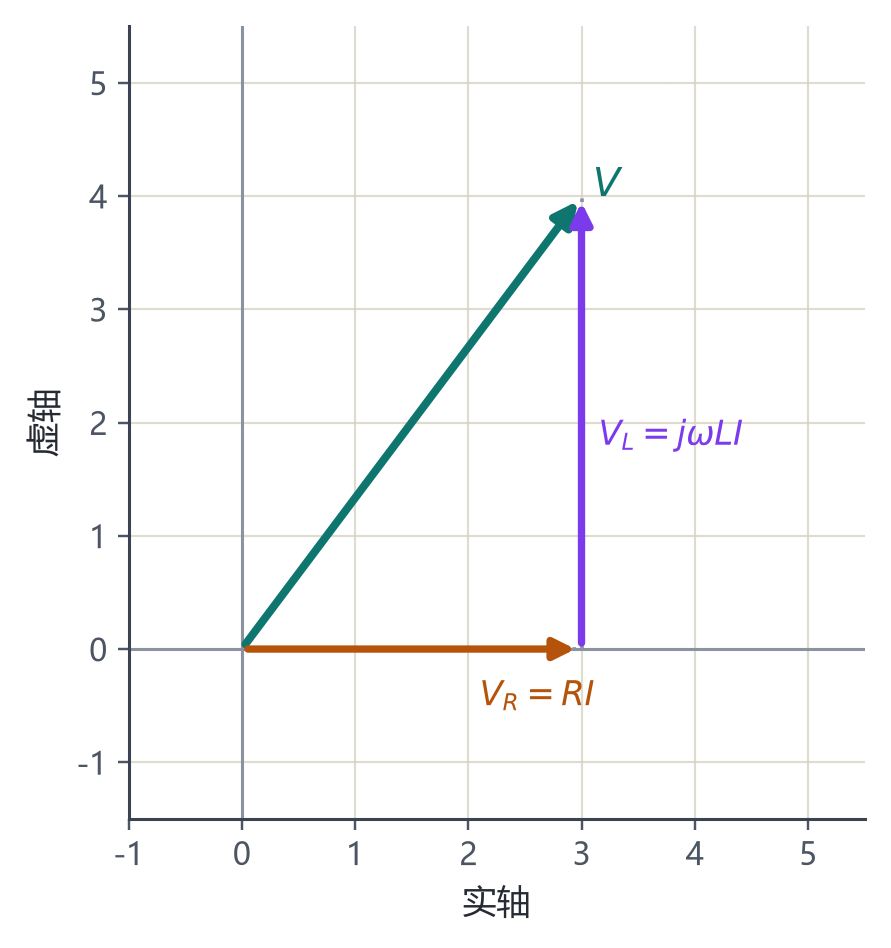

*相量首尾相接：$V_{R}$ 与 I 同相，$V_{L}$ 超前 90°，两者合成 V*

> **几何直觉：**$V_{R}$、$V_{L}$ 是直角三角形的两条直角边，V 是斜边。所以 |V|² = |$V_{R}$|² + |$V_{L}$|²，相位角 tan φ = ωL/R。复数运算只是把勾股定理和角度合成了一次。

### 五、节点法、网孔法与戴维南：配方不变，数变复数

节点法：对每个节点写 KCL，支路电流用 ($V_{i}$ − $V_{j}$)/Z 表示，得到复数矩阵 G·V = I。网孔法：对每个网孔写 KVL，得到 Z·I = V。戴维南：开路电压 $V_{oc}$、等效阻抗 $Z_{eq}$，负载电流 I = $V_{oc}$/($Z_{eq}$ + $Z_{L}$)。

需要注意的只有两件事：第一，Z 依赖频率 ω，换频率就要重算；第二，含受控源时矩阵不再对称，但解法不变。

### 六、谐振与 Q：虚部抵消之后

串联 RLC 的阻抗是：

$$
Z = R + j(ωL - \frac{1}{(ωC)})
$$

当感抗与容抗相等时，虚部为零：

$$
ω_{0}L = \frac{1}{(ω_{0}C)}\quad \Rightarrow \quad ω_{0} = \frac{1}{\sqrt{LC}}
$$

此时 Z = R，电流最大；L 和 C 的电压大小相等、方向相反，互相抵消，但各自可能远大于源电压。这就是串联谐振的“电压放大”。

把阻抗写成归一化形式，能看清 Q 的作用：

$$
\begin{aligned}\frac{Z}{R} = 1 + jQ(\frac{ω}{ω_{0}} - \frac{ω_{0}}{ω})\\Q = \frac{ω_{0}L}{R} = \frac{1}{(ω_{0}CR)}\end{aligned}
$$

### 推导 · 带宽为什么是 ω₀/Q

$$
Q(\frac{ω}{ω_{0}} - \frac{ω_{0}}{ω}) = ±1
$$

$$
Qx^{2} ∓ x - Q = 0
$$

$$
B = ω_{2} - ω_{1} = \frac{ω_{0}}{Q}
$$

Q 越高，带宽越窄，选择性越好；但储能元件的建立时间也越长，这就是“选得准”和“变得快”的取舍。

### 再深入一点：Q 的物理意义与并联谐振

Q 不只出现在公式里。它的定义是：

$$
Q = 2π \times \frac{\text{每周期储存的能量}}{\text{每周期损耗的能量}}
$$

串联时，电流相同，能量在 L、C 之间来回倒；R 每个周期拿走一部分，所以 Q = $ω_{0}$L/R。Q 高，意味着“存得多、耗得少”，振铃更久。

并联谐振是对偶的：端电压相同，L、C 支路电流等幅反相，总电流最小。用导纳写：

$$
\begin{aligned}Y = G + j(ωC - \frac{1}{(ωL)})\\ω_{0} = \frac{1}{\sqrt{LC}}\\Q = \frac{R}{(ω_{0}L)} = ω_{0}CR\end{aligned}
$$

串联看阻抗最小，并联看导纳最小；一个“电流最大”，一个“端电压最大”。

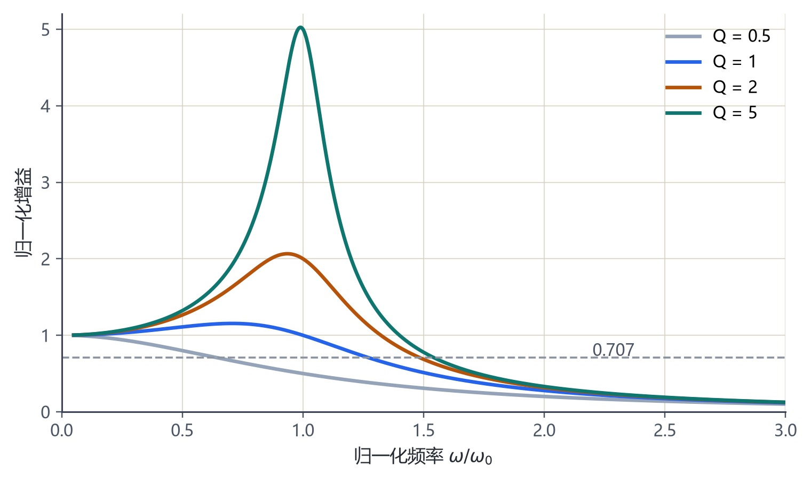

*Q 越高，峰越尖、带宽越窄；代价是建立更慢、振铃更久*

### 七、从相量到功率、再到频响

相量法解决的是“同一个频率下的幅值和相位”。下一节功率会用到它：把电压相量乘以电流的**共轭**，就得到复功率 S = V I\* = P + jQ。再往后，频率响应把 ω 当作变量扫过去，Z(jω) 就变成了网络函数 H(jω)。

所以这条线是连贯的：

$$
\text{微分方程} → \text{正弦稳态} → \text{相量} → \text{阻抗} → \text{复数电路方程} → \text{功率} → \text{频响}
$$

> **别踩坑：**一张相量图只能对应一个频率；不同频率的源要各自算、各自变回时间函数，再叠加；正弦必须先化成余弦再取相量；峰值相量与有效值相量不能混用；阻抗是复数，不是“电阻加电抗”的实数。

> 🎚️
> 现实里：收音机调台
> 旋转调台旋钮，其实是在改变电容值，让 LC 的谐振频率对准某个电台。电台频率不同，LC 对其他频率“不感兴趣”，这就是选择性的来源；而 Q 越高，选台越尖，但音质和建立时间也会受影响。

> **一句话记住**正弦装进复指数，求导就乘 jω；电路定律照搬，实数换复数。

*脉络上游：复数、正弦、二阶暂态→本节：相量 + 阻抗→下游：功率、频率响应、滤波器*

## 11 · 交流功率：有功、无功与功率因数

*谁在真正干活*

正弦电压电流的瞬时功率一直在脉动。一个周期平均下来，只有电阻真正消耗功率；电感和电容只是把能量“借走再还回来”。

> **互动 · 功率三角形**

> 视在功率固定 1000 VA。拖动功率因数，看有功和无功怎么此消彼长。

### 三个功率

- **有功 P**：真正被消耗的，单位 W。

- **无功 Q**：在 L、C 之间来回跑的，单位 var。

- **视在 S**：电压有效值乘电流有效值，单位 VA，是设备的“容量占用”。

功率因数是电压与电流相位差的余弦。功率因数低，线路电流就大，设备和导线都要加粗，所以电力公司要罚款。

**校正：**在感性负载旁并联电容，用容性无功抵消感性无功，功率因数就上去了，线路电流反而变小。

$$
\begin{aligned}P = V_{rms} I_{rms} \cos φ\\S = P + jQ\end{aligned}
$$

> **别踩坑：**视在功率不是有功功率；无功不是“没用的功率”，它只是不消耗，但会占线路容量；共轭匹配才是最大有功，不是“负载等于内阻”那么简单。

### 再深入一点：瞬时功率、无功与复功率

设 v = $V_{m}$cos(ωt)，i = $I_{m}$cos(ωt − φ)，瞬时功率可以拆成两块：一块是不随时间变的平均功率，一块是以 2ω 频率脉动的部分。

平均功率 P = $V_{rms}$$I_{rms}$cosφ；无功功率 Q = $V_{rms}$$I_{rms}$sinφ；视在功率 S = $V_{rms}$$I_{rms}$。三者满足 S² = P² + Q²，画出来就是功率三角形。

无功不是“白干的活”，它在电感、电容之间来回搬运，不消耗但有占线路容量。并联电容做功率因数校正，就是把感性无功抵消掉，让线路电流降下来。

$$
\begin{aligned}p(t) = P + P cos2ωt + Q sin2ωt\\P = VIcosφ\\Q = VIsinφ\\S = P + jQ\end{aligned}
$$

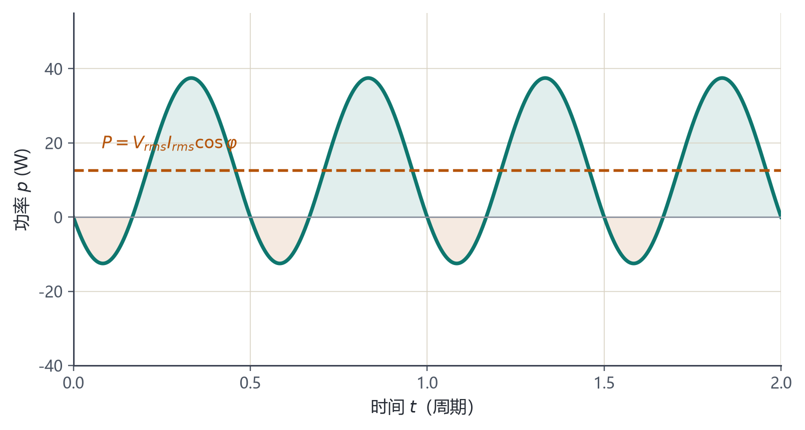

*瞬时功率会“回落”，但平均值由有功决定*

### 补遗：功率因数校正与共轭匹配

- 感性负载的电流滞后电压，功率因数低；在负载端并联电容，用容性无功去抵消感性无功，总电流会下降。

- 不要“过补偿”：电容太大，电流又会从滞后变超前，线路电流反而回升。

- 源有内阻抗时，负载取内阻抗的**共轭**，拿到的有功最大；只让电阻相等、电抗不抵消，是拿不到最大功率的。

功率因数校正省的是“线路容量”，不是“负载消耗的有功”。电费里的有功部分不会因为并联电容而减少。

### 推导：瞬时功率怎么拆成“平均 + 2ω 脉动”

设 v = $V_{m}$cos(ωt)，i = $I_{m}$cos(ωt − φ)。用积化和差：

$$
p = vi = (\frac{V_{m}I_{m}}{2})[cosφ + \cos(2ωt - φ)]
$$

再把 cos(2ωt − φ) 展开，并令 V、I 为有效值：

$$
\begin{aligned}p = P + Pcos2ωt + Qsin2ωt\\P = VIcosφ, Q = VIsinφ\end{aligned}
$$

前两项是平均功率和以 2ω 脉动、平均为零的分量；第三项是“来回搬运”的无功分量。电流滞后时 Q > 0，波形在平均线上下不再对称。

### 再深入一点：复功率与最大功率传输

用有效值相量定义**复功率**：

$$
\begin{aligned}S = V I* = P + jQ\\P = \operatorname{Re}\left\{S\right\} = VIcosφ\\Q = \operatorname{Im}\left\{S\right\} = VIsinφ\end{aligned}
$$

其中 I\* 是电流的共轭。只有电阻消耗有功；电感、电容的无功会来回搬运，不消耗，但占用线路容量。

负载从有内阻抗的源拿最大有功，条件是**共轭匹配**：

$$
\begin{aligned}Z_{L} = Z_{s}*\\R_{L} = R_{s}, X_{L} = -X_{s}\\P_{max} = |V_{oc}|\frac{^{2}}{(4R_{s})}\end{aligned}
$$

只让电阻相等、电抗不抵消，拿不到最大功率；只让模相等，也不对。

共轭匹配时，源内阻和负载电阻各消耗一半有功，所以效率只有 50%。这不是“最省电”的匹配，而是“负载拿到最多有功”的匹配。

电力系统追求的是高效率，不会故意让线路阻抗等于负载；只有小信号、通信、音频等“要最大功率”的场合才做共轭匹配。

$$
\begin{aligned}η = \frac{P_{L}}{(P_{L} + P_{s})}\\\text{共轭匹配时} η = 50\%\end{aligned}
$$

如果负载电抗不可调，只能调电阻，最大功率条件会变成 $R_{L}$ = |$Z_{s}$|，而不是 $R_{s}$。

> 🏭
> 现实里：工厂的无功补偿柜
> 工厂里大量电机是感性负载，功率因数低，线路电流大、电费高。并联电容柜把无功“就地补掉”，线路电流降下来，同样的有功可以用更细的线送——这就是功率因数校正。

*高压输电线路：升压降低线路损耗，是变压器最宏大的应用。 [图源：Matthew T Rader / CC BY-SA 4.0](https://commons.wikimedia.org/wiki/File:Transmission_towers_at_sunset_in_East_Texas.jpg)*

> **一句话记住**有功干活，无功往返，视在占容量。

*脉络上游：相量→本节→下游：匹配与校正*

## 12 · 频率响应与滤波：电路对不同频率的态度

*扫频 · Bode · 谐振*

固定电路，改变输入正弦的频率，看输出幅度和相位怎么变——这就是频率响应。滤波器就是一只“筛子”。

> **互动 · 一阶低通的 Bode 图**

> 拖动截止频率。注意转折点之后，曲线每十倍频下降 20 dB。

### 四种筛子

- **低通**：低频过，高频挡。

- **高通**：高频过，低频挡。

- **带通**：只放行中间一段。

- **带阻**：只挡掉中间一段（陷波）。

谐振电路的带宽是“增益不低于 0.707 倍”的频率范围。带宽等于谐振频率除以 Q：Q 越高，带宽越窄，选择性越好，但建立越慢、越容易振铃。

**Bode 图**把增益取对数、频率也取对数：串联环节的增益相乘，变成相加；每个极点、零点在转折频率处改变一次斜率。

$$
A_{dB} = 20 log_{10} |H|
$$

> **别踩坑：**分贝是 20log（电压比），不是 10log；0 dB 表示“幅度不变”，不是“没有输出”；截止频率处是 −3 dB，不是 0 dB。

### 再深入一点：四种滤波器与 Bode 渐近线

频率响应 H(jω) 同时给出两件事：幅度怎么变（增益）、相位怎么移。把增益取 20log，频率取对数，就得到 Bode 图；每个极点在高频段贡献 −20 dB/十倍频，每个零点贡献 +20 dB/十倍频。

一阶低通的转折点在 $ω_{c}$ = 1/RC，转折点本身是 −3 dB；一阶高通正好相反。带通只放行中间一段，带阻只挡掉中间一段。谐振电路的带宽 B = $ω_{0}$/Q，Q 越高越“挑食”。

有源滤波用运放加 RC，避开电感；但运放有增益带宽积 GBW 的限制：闭环增益越大，可用带宽越窄。

$$
\begin{aligned}A_{dB} = 20log|H|\\\text{一阶低通：}-20 \frac{dB}{dec}\\B = \frac{ω_{0}}{Q}\\GBW = A_{0}ω_{a}\end{aligned}
$$

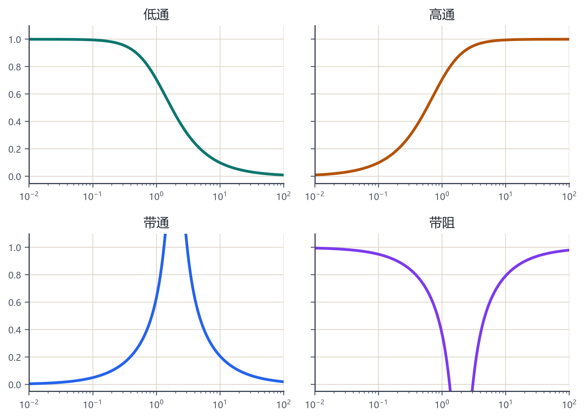

*四种“筛子”：低通、高通、带通、带阻*

### 推导：一阶低通的 H(jω)、截止频率与 −20 dB/dec

**思路：**把电容换成阻抗，用分压公式；再把结果写成“模 + 相位”。

$$
\begin{aligned}H(jω) = \frac{V_{out}}{V_{in}} = \frac{Z_{C}}{(R + Z_{C})}\\Z_{C} = \frac{1}{(jωC)}\end{aligned}
$$

代入并上下同乘 jωC：

$$
H(jω) = \frac{1}{(1 + jωRC)}
$$

令 $ω_{c}$ = 1/(RC)，则：

$$
\begin{aligned}H(jω) = \frac{1}{(1 + \frac{jω}{ω_{c}})}\\|H| = \frac{1}{\sqrt{}}(1 + (\frac{ω}{ω_{c}})^{2})\\φ = -\arctan(\frac{ω}{ω_{c}})\end{aligned}
$$

当 ω = $ω_{c}$ 时 |H| = 1/√2 ≈ 0.707，所以叫 −3 dB 点；当 ω ≫ $ω_{c}$ 时 |H| ≈ $ω_{c}$/ω，频率乘 10，幅度除以 10，即 −20 dB/dec。

这就是 Bode 图斜率的来源：一个极点贡献 −20 dB/dec，一个零点贡献 +20 dB/dec。

### 再深入一点：网络函数与串、并联谐振

**网络函数**是响应相量与激励相量之比：

$$
H(jω) = \text{响应相量} / \text{激励相量}
$$

按响应、激励是电压还是电流，分为四类：电压增益、电流增益、转移阻抗、转移导纳。分母中 jω 的最高次数就是网络阶数；分母的根是极点，分子的根是零点。

- **策动点**：同一端口，输入阻抗或输入导纳。

- **转移函数**：跨端口，电压/电流增益或转移阻抗/导纳。

- **极点**：让 H→∞ 的 s 值，决定稳定与响应形状。

- **零点**：让 H=0 的 s 值，只改比例与波形。

串联 RLC 的阻抗：

$$
\begin{aligned}Z = R + j(ωL - \frac{1}{(ωC)})\\ω_{0} = \frac{1}{\sqrt{LC}}\\Q = \frac{ω_{0}L}{R}\end{aligned}
$$

谐振时 Z=R，电流最大；L、C 电压大小相等、方向相反，各自是源电压的 Q 倍。带宽 B=$ω_{0}$/Q。

**并联谐振**是对偶的：端电压相同，L、C 支路电流等幅反相，总电流最小。

$$
\begin{aligned}Y = G + j(ωC - \frac{1}{(ωL)})\\ω_{0} = \frac{1}{\sqrt{LC}}\\Q = \frac{R}{(ω_{0}L)} = ω_{0}CR\end{aligned}
$$

并联谐振时导纳最小、端电压最大；L、C 支路电流是总电流的 Q 倍。串联看“电压放大”，并联看“电流放大”。

Bode 图把增益取 20log、频率取对数：一个极点贡献 −20 dB/dec，一个零点贡献 +20 dB/dec；转折频率处是 −3 dB。

$$
\begin{aligned}A_{dB} = 20log|H(jω)|\\\text{一阶低通：}ω_{c} = \frac{1}{(RC)}\\B = \frac{ω_{0}}{Q}\end{aligned}
$$

滤波器的“陡不陡”由阶数决定：一阶 −20 dB/dec，二阶 −40 dB/dec；但阶数越高，相位滞后越大，也越容易振铃。

> 🎧
> 现实里：耳机的分频与降噪
> 入耳式耳机常用 RC/LC 分频，把低频送大喇叭、高频送小喇叭。降噪耳机则用麦克风采噪声，反相后叠加，把低频噪声“抵消”——本质是一个频率选择性系统。

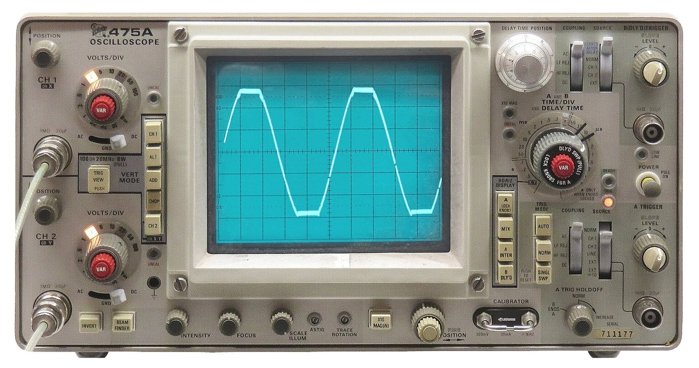

*示波器：把电压波形画在屏幕上，频率、相位、幅值一目了然。 [图源：Pittigrilli / CC BY-SA 4.0](https://commons.wikimedia.org/wiki/File:Tektronix_Oscilloscope_475A.jpg)*

> **一句话记住**滤波就是筛频率；Bode 把乘法变加法。

*脉络上游：相量→本节→下游：拉氏与傅里叶*

## 13 · 拉普拉斯：把微积分变成代数

*s 域 · 系统函数 · 极点*

微分方程难解，是因为有导数。拉普拉斯变换把时间函数变成复频率 s 的函数：微分变成乘 s，积分变成除 s，方程立刻变成代数方程。

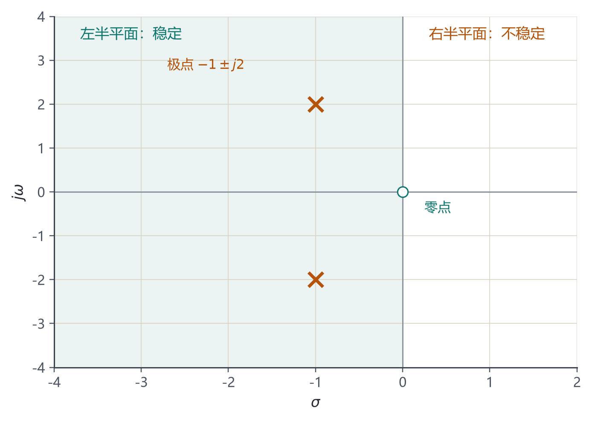

*极点住在左半平面，电路就稳定；跑到右半平面，响应会发散*

### 电路在 s 域长什么样

- 电阻：还是 R。

- 电感：变成 sL，初始电流变成附加源。

- 电容：变成 1/(sC)，初始电压变成附加源。

于是节点法、网孔法、戴维南全部照搬，只是把阻抗写成 s 的函数，初始条件写成电源。

**四步：**画 s 域模型 → 列方程解出响应 → 部分分式展开 → 查表变回时间函数。

$$
V_{C}(s) = \frac{V_{0}}{s(1 + sRC)} → v_{C}(t) = V_{0}(1 - e^{-\frac{t}{RC}})
$$

**系统函数**是零初始条件下输出与输入的 s 域比值，相当于电路的“身份证”：极点定稳定与快慢，零点改波形形状，冲激响应就是它的反变换。

> **别踩坑：**初始条件源的极性容易画反；s 域解只在接通以后有效，别拿它去解释接通前的行为。

### 再深入一点：s 域模型与初始条件

拉普拉斯变换把微分变成乘 s、积分变成除 s。对单边信号，微分性质还要减去初始值：$\mathcal{L}\left\{\frac{dx}{dt}\right\}=sX(s)-x(0^-)$。

于是电容不再是单纯的 1/(sC)，还要串一个 v(0⁻)/s 的电压源；电感不再是单纯的 sL，还要串一个 L i(0⁻) 的电压源（也可改成并联电流源）。初始条件就这样变成了“附加电源”。

零初始条件下，输出与输入的 s 域比值就是系统函数 H(s)。极点全在左半平面则稳定；冲激响应就是 H(s) 的反变换；时域卷积在 s 域变成乘法。

$$
\begin{aligned}\mathcal{L}\left\{\frac{dx}{dt}\right\}&=sX-x(0^-)\\ V_C&=\frac{I}{sC}+\frac{v(0^-)}{s}\\ V_L&=sLI-L\,i(0^-)\end{aligned}
$$

> **互动 · 时域 ↔ s 域**

> 拉普拉斯把微分变成乘法：电容 1/sC、电感 sL，初值变成附加源。

### 补遗：拉氏变换的常用性质

- **线性**：L{ax₁ + bx₂} = aX₁ + bX₂。

- **时移**：L{x(t − a)u(t − a)} = $e^{−as}$X(s)。

- **频移**：L{$e^{−at}$x(t)} = X(s + a)。

- **尺度**：L{x(at)} = (1/a)X(s/a)，a > 0。

- **卷积**：L{x₁ \* x₂} = X₁(s)X₂(s)。

- **初值/终值**：在极点都稳定的前提下，可由 sX(s) 的极限读出初值和终值。

这些性质把“解微分方程”变成“查表 + 代数”。真正的难点不在变换，而在建模：初始条件有没有画成源、受控源有没有贴住。

### 推导 · 微分性质为什么是 sX − x(0)

$$
\mathcal{L}\{x'\}=\int_0^\infty x'(t)e^{-st}\,dt
$$

$$
=\left[x(t)e^{-st}\right]_0^\infty+s\int_0^\infty x(t)e^{-st}\,dt
$$

$$
\mathcal{L}\{x'\}=sX(s)-x(0^-)
$$

这就是为什么 s 域模型里会多出“初始条件电源”：不是硬加的，是分部积分掉出来的。

> 🚗
> 现实里：控制系统与汽车悬挂
> 工程师用拉氏变换把“弹簧—质量—阻尼”的微分方程变成代数式，算极点、画根轨迹，判断车会不会抖、刹车会不会点头。你坐的车，悬挂参数就是这么调出来的。

> **一句话记住**微分变乘 s，初始条件变电源。

*脉络上游：微分方程→本节→下游：傅里叶与稳定*

## 14 · 傅里叶：把波形拆成“音叉”

*频谱 · 谐波 · 吉布斯*

任何周期波形，都能拆成许多正弦波之和：一个基波，加上频率是整数倍的高次谐波。拆出来的每一条“谱线”，就是频谱。

> **互动 · 方波的合成**

> 增加谐波项数。看跳变附近的过冲——加得再多，它也不会消失。

### 频谱的两种长相

- **周期信号**：频谱是一根根离散的谱线。

- **非周期信号**：频谱变成连续的曲线。

方波有跳变，谐波按 1/n 慢慢衰减，所以要很多项才能接近；跳变附近总有约 9% 的过冲，加项只会让它变窄——这就是**吉布斯现象**。

**负频率**不是反向旋转的物理波，而是实信号双边谱的数学对称。只保留正频率就得到解析信号，它的虚部是原信号的希尔伯特变换（全局 90° 移相）。

$$
\begin{aligned}x(t) = \sum c_{n} e^{jnω_{0}t}\\c_{n} \text{按} \frac{1}{n} \text{衰减（}\text{方波）}\end{aligned}
$$

> **别踩坑：**频谱冲激前面的 2π 别漏；负频率不是“不存在”，而是共轭对称的另一半；时域压得越窄，频域展得越宽。

### 再深入一点：频谱、负频率与能量

傅里叶变换把非周期波形拆成连续的正弦谱，傅里叶级数把周期波形拆成离散的谱线。方波的谐波幅度按 1/n 衰减，所以跳变附近总有过冲（吉布斯现象）。

几条好用的性质：时移只改相位，频移把频谱整体搬家（调制），尺度变换让时域与频域“你窄我宽”，时域卷积对应频域相乘。

实信号的频谱必须共轭对称，所以正频率旁边总有“负频率”。只保留正频率得到解析信号，它的虚部是原信号的希尔伯特变换（全局 90° 移相）。Parseval 定理说：时域能量等于频域能量。

$$
\begin{aligned}X(ω) = \int x(t)e^{-jωt}dt\\c_{n} = (\frac{1}{T})\int x(t)e^{-jnω_{0}t}dt\\\int |x|^{2}dt = (\frac{1}{2π})\int |X|^{2}dω\end{aligned}
$$

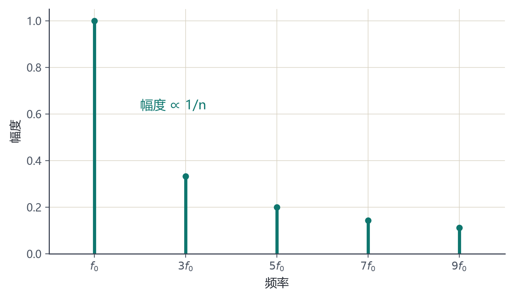

*方波的频谱：一根根离散的奇次谐波，包络按 1/n 衰减*

### 补遗：傅里叶变换的常用性质

- **时移**：x(t − a) ↔ $e^{−jωa}$X(ω)。

- **频移**：$e^{jω₀t}$x(t) ↔ X(ω − ω₀)；乘余弦就是把频谱左右各搬一半。

- **尺度**：x(at) ↔ (1/|a|)X(ω/a)。时域越窄，频域越宽。

- **微分**：dx/dt ↔ jωX(ω)；积分要多加一个 kδ(ω)，这个常数最容易被漏。

- **对称**：X(t) ↔ 2πx(−ω)。

实信号的幅度谱是偶函数、相位谱是奇函数；这不是巧合，而是“负频率必须成对出现”的结果。

### 推导 · 傅里叶系数为什么那样算

$$
x(t) = \sum c_{n} e^{jnω_{0}t}
$$

$$
\int _{T} x(t)e^{-jmω_{0}t}dt = \sum c_{n} \int _{T} e^{j(n-m)ω_{0}t}dt
$$

$$
\int _{T} x(t)e^{-jmω_{0}t}dt = c_{m} T
$$

$$
c_{m} = (\frac{1}{T})\int _{T} x(t)e^{-jmω_{0}t}dt
$$

“正交性”就是不同频率的复指数在一个周期内“互相抵消”，所以能把系数一个个“筛”出来。

> 🎵
> 现实里：音频均衡器与 JPEG
> 均衡器把音乐拆成多个频段，分别调大调小；JPEG 把图像分成 8×8 小块做频域变换，丢掉人眼不敏感的高频。它们用的都是“换一组基”的思想。

> **一句话记住**波形拆成音叉，频谱就是配方。

*脉络上游：拉普拉斯→本节→下游：双口与通信*

## 15 · 双口与变压器：两个门，一对线圈

*端口参数 · 互感 · 阻抗折算*

双口是一个有两个“门”的黑箱，每个门一进一出。变压器则是两个线圈共享磁场，像一对咬合的齿轮。

> **互动 · 理想变压器**

> 一次侧 10 V，二次侧接 8 Ω。拖动匝比，看二次电压和折算到一次侧的阻抗。

### 双口的四种“记账法”

- **z 参数**：端口电压写成电流的函数，测时让一个端口开路。

- **y 参数**：端口电流写成电压的函数，测时让一个端口短路。

- **ABCD**：输入写成输出的函数，最适合级联。

- **h 参数**：混合着来，晶体管手册最爱用。

串联 z 相加，并联 y 相加，级联 ABCD 相乘。连接后如果某个端口不再“一进一出”，简单相加就不成立。

**互感**：一个线圈的电流变化，会在另一个线圈里感应电压。符号画不出绕向，就用同名端（黑点）标记。

$$
\begin{aligned}v_{2} = N v_{1}\\i_{2} = -\frac{i_{1}}{N}\\Z_{in} = N^{2} Z_{L}\end{aligned}
$$

**理想变压器**是全耦合、无损耗、电感无穷大的极限：电压比等于匝比，电流比是匝比的倒数，功率一点不丢。它还能变换阻抗：从一次侧看，二次侧负载要乘匝比的平方。

> **别踩坑：**同名端看反，互感项符号就错；匝比方向看反，电压电流比全反；把理想变压器当成“直流也能变压”的器件——真实变压器在直流下只是两段导线。

### 再深入一点：四种参数、T 型等效与变压器

双口有两个端口，每个端口必须“一进一出”。z 参数把端口电压写成电流的函数（另一端开路测），y 参数反过来（另一端短路测），ABCD 适合级联，h 参数适合晶体管。

双口可以等效成 T 型（三个阻抗）或 π 型（三个导纳）。串联时 z 相加，并联时 y 相加，级联时 ABCD 相乘。含独立源的双口多出常数项，可求双口戴维南。

互感把两个线圈绑在一起：λ₁ = L₁i₁ + Mi₂，λ₂ = Mi₁ + L₂i₂。同名端标记绕向；耦合系数由互感与自感决定。理想变压器是 k = 1、电感无穷大的极限：电压比等于匝比，电流比是倒数，阻抗按匝比平方折算。

$$
\begin{aligned}v_{2} = N v_{1}\\i_{2} = -\frac{i_{1}}{N}\\Z_{in} = N^{2}Z_{L}\\k = M/\sqrt{L_{1}L_{2}}\end{aligned}
$$

> **互动 · 双口与同名端**

> 拖动匝比 N，看二次电压、电流和同名端的方向怎么变。

### 再深入一点：互感、同名端与耦合电感方程

两个线圈共享磁场时，一个线圈的电流变化会在另一个线圈里感应电压，这就是**互感**。设两个线圈的电流都从同名端流入：

$$
\begin{aligned}ψ_{21} = M i_{1}\\v_{21} = M \frac{di_{1}}{dt}\\v_{12} = M \frac{di_{2}}{dt}\end{aligned}
$$

每个线圈的总电压 = 自感电压 + 互感电压：

$$
\begin{aligned}v_{1} = \frac{L_{1}di_{1}}{dt} + M \frac{di_{2}}{dt}\\v_{2} = M \frac{di_{1}}{dt} + \frac{L_{2}di_{2}}{dt}\end{aligned}
$$

相量形式：

$$
\begin{aligned}V_{1} = jωL_{1}I_{1} + jωM I_{2}\\V_{2} = jωM I_{1} + jωL_{2}I_{2}\end{aligned}
$$

如果有一个电流从同名端流出，对应的互感项前面加负号。同名端不是“正极”，它只标记绕向；看反了，互感项的符号就反了。

**耦合系数**衡量两个线圈“咬合”得多紧：

$$
k = M/\sqrt{L_{1}L_{2}}, 0 ≤ k ≤ 1
$$

k = 0 无耦合，k = 1 全耦合。理想变压器是 k = 1 且 L → ∞ 的极限。

同名端在同一侧时，耦合电感可以等效成 T 型：两个串联臂 $L_{1}$−M、$L_{2}$−M，中间并联臂 M。这样就把“磁耦合”变成了三个普通电感。

$$
T \text{型：}L_{1}-M, L_{2}-M, M
$$

储能：

$$
w = \tfrac{1}{2}L_{1}i_{1}^{2} + \tfrac{1}{2}L_{2}i_{2}^{2} + M i_{1}i_{2}
$$

互感本身不耗能，但会改变能量在两个线圈之间的分配；耦合过强或方向不对，可能让等效电感出现负值。

### 补遗：ABCD、h 参数与互联条件

- **ABCD**：\[V₁; I₁\] = \[A B; C D\]\[V₂; −I₂\]。级联时矩阵直接相乘；互易双口满足 AD − BC = 1。

- **h 参数**：V₁ = h₁₁I₁ + h₁₂V₂，I₂ = h₂₁I₁ + h₂₂V₂。晶体管手册里的 $h_{fe}$、$h_{ie}$ 就是它。

- **互联**：串联 z 相加、并联 y 相加、级联 ABCD 相乘——前提是互联后每个端口仍然“一进一出”。

- **T 型/π 型**：z 参数对应 T 型（两个串联臂 + 一个并联臂），y 参数对应 π 型（三个导纳）。

双口理论的价值在于“模块化”：把放大器、滤波器、反馈网络各看成一个双口，先分别测参数，再按连接方式组合。

### 推导 · 变压器为什么能把阻抗“放大 N² 倍”

$$
v_{2} = N v_{1}\quad \quad i_{2} = - \frac{i_{1}}{N}
$$

$$
N v_{1} = Z_{L} \cdot (\frac{i_{1}}{N})\quad \Rightarrow \quad \frac{v_{1}}{i_{1}} = \frac{Z_{L}}{N^{2}}
$$

$$
Z_{in} = N^{2} Z_{L}
$$

所以 1:2 的变压器把 8 Ω 负载“折”成 32 Ω；反过来，2:1 就把 32 Ω 折成 8 Ω。阻抗匹配就是靠这个平方关系。

> 🔋
> 现实里：充电头与电网升压
> 手机充电头里有一个高频变压器，把电压降下来、把阻抗“折”到开关管舒服的数值。电网用升压变压器把电送到远方，再用降压变压器送到你家——都是为了减少线路损耗、匹配阻抗。

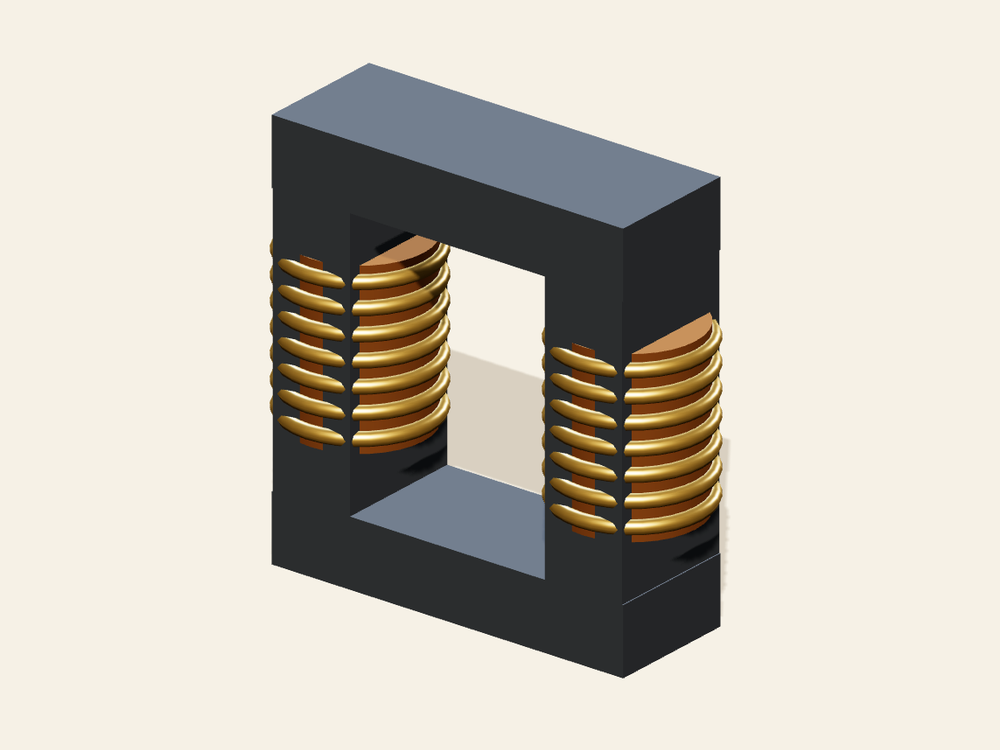

*小功率变压器：匝比决定电压比与阻抗折算。 Three.js 3D 渲染*

> **一句话记住**双口是模块，变压器是磁齿轮。

*脉络上游：等效与双口→本节→下游：反馈与匹配*

## 16 · 三相电路：三根线，一个旋转的场

*Y/Δ · 线电压 · 三相功率*

单相电只能让一个线圈“来回推”；三相电让三个线圈按 120° 轮流推，合成一个匀速旋转的磁场。工业电机、电网、楼宇配电，基本都是三相。

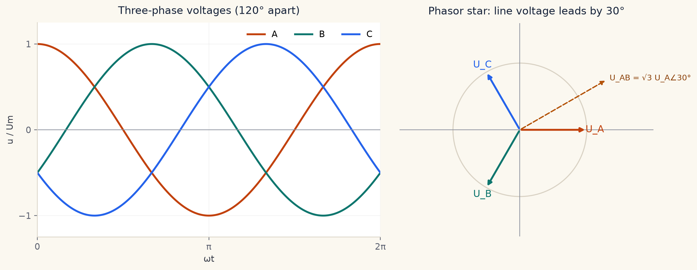

*三相对称电源：三路正弦幅值相等、相位互差 120°；线电压 $U_{AB}$ 是相电压的 √3 倍，并超前 30°*

### 一、对称三相电源

三相对称电源由三个幅值相等、频率相同、相位互差 120° 的正弦源组成。以 A 相为参考：

$$
\begin{aligned}u_{A} = U_{m} \cos(ωt)\\u_{B} = U_{m} \cos(ωt - 120^{\circ})\\u_{C} = U_{m} \cos(ωt + 120^{\circ})\end{aligned}
$$

三者瞬时值之和恒为零：

$$
u_{A} + u_{B} + u_{C} = 0
$$

这就是“三根线能代替六根线”的根本原因：对称时，返回电流在任意瞬间互相抵消。相序 A→B→C 叫正序；交换任意两根线，旋转磁场就会反转。

### 二、Y 与 Δ：线量、相量

先把三个词分清：**相电压**是每相绕组两端的电压，**线电压**是两根火线之间的电压；**相电流**是绕组里的电流，**线电流**是火线里的电流。

| 连接 | 线电压 | 线电流 | 相位关系 |
|---|---|---|---|
| Y（星形） | $U_{L} = \sqrt{3} U_{P}$ | $I_{L} = I_{P}$ | 线电压超前对应相电压 30° |
| Δ（三角形） | $U_{L} = U_{P}$ | $I_{L} = \sqrt{3} I_{P}$ | 线电流滞后对应相电流 30° |

这就是常说的“380 V、220 V”：Y 接时线电压 380 V，相电压 220 V，二者相差 √3 倍。

$$
\begin{aligned}Y：U_{L} = \sqrt{3} U_{P}, I_{L} = I_{P}\\Δ：U_{L} = U_{P}, I_{L} = \sqrt{3} I_{P}\end{aligned}
$$

### 三、对称三相怎么算：只算一相

如果电源对称、负载也对称，那么三相的电压、电流只是彼此相差 120° 的“复制品”。算出 A 相，B、C 相直接旋转 −120°、+120° 即可。

### 思路：把三相化成单相

$$
\begin{aligned}U_{A} = U_{P}\angle 0^{\circ}, U_{B} = U_{P}\angle -120^{\circ}, U_{C} = U_{P}\angle 120^{\circ}\\I_{A} = \frac{U_{A}}{Z_{Y}}, I_{B} = I_{A}\angle -120^{\circ}, I_{C} = I_{A}\angle 120^{\circ}\\I_{N} = I_{A} + I_{B} + I_{C} = 0（\text{对称）}\end{aligned}
$$

### 例题：380 V 线电压，Y 形负载

三相对称电源线电压 380 V，Y 形负载每相 Z = 10∠30° Ω。求相电压、相电流、三相有功和无功。

$$
\begin{aligned}U_{P} = \frac{380}{\sqrt{3}} \approx 220 V\\I_{P} = \frac{220}{10} = 22 A\\P = \sqrt{3} \times 380 \times 22 \times cos30^{\circ} \approx 12.5 kW\\Q = \sqrt{3} \times 380 \times 22 \times sin30^{\circ} \approx 7.2 kvar\end{aligned}
$$

三个相电流大小相等，相位互差 120°；中线电流为零。每相负载吸收约 4.17 kW，三相合计 12.5 kW。

> **为什么乘 √3：**三相总功率是三个单相功率之和。用线量写时，Y 接的相电压是 $U_{L}$/√3，代入 $3U_{P}$$I_{P}$cosφ 就得到 √$3U_{L}$$I_{L}$cosφ；Δ 接的相电流是 $I_{L}$/√3，结果相同。

### 四、三相功率

对称三相的瞬时功率是恒定的，不像单相那样以 2ω 脉动；这是三相电机转矩平稳的原因。

$$
\begin{aligned}P = 3U_{P}I_{P}cosφ = \sqrt{3} U_{L}I_{L}cosφ\\Q = 3U_{P}I_{P}sinφ = \sqrt{3} U_{L}I_{L}sinφ\\S = 3U_{P}I_{P} = \sqrt{3} U_{L}I_{L}\end{aligned}
$$

对称三相还可以用**两表法**测功率：两个瓦特计的读数 P₁、P₂ 之和就是三相总有功；无功可由 Q = √3(P₁ − P₂) 得到（注意接法与相序）。

### 五、不对称与中线

实际负载常常不对称：一相重、两相轻。这时三个相电流不再互差 120°，中线电流不再为零。

- **四线制、中线可靠：**各相电压仍被电源钳住，负载各自工作，但中线电流可能很大。

- **三线制、无中线：**中性点会“漂移”，负载重的相电压降低、轻的相电压升高，可能烧坏设备。

- **中线不能装开关或熔断器：**中线一断，三相电压失去约束，这就是“断零”事故。

$$
I_{N} = I_{A} + I_{B} + I_{C} ≠ 0（\text{不对称）}
$$

> **别踩坑：**把线电压和相电压混用；Y 接用 $U_{L}$=√$3U_{P}$，Δ 接用 $I_{L}$=√$3I_{P}$，别记反；对称才能去掉中线；不对称时不要用“只算一相”的捷径。

> 🏭
> 现实里：工厂电机与楼宇配电
> 三相异步电机接三根火线就能产生旋转磁场，结构简单、转矩平稳。楼宇配电把三相分到不同楼层，尽量让各相负载平衡；单相空调、照明最终都挂在某一相与中线之间。

> **一句话记住**三相对称只算一相；Y 看 √3 电压，Δ 看 √3 电流；中线只对对称负载可省。

*脉络上游：单相正弦稳态→本节：三相电路→下游：电机、配电与功率测量*

## ★ · 知识脉络：把整本书串成一条线

*从“点”到“网”*

零散的知识点像零件，脉络才是装配图。整本书其实只有六条线；每条线都回答同一个问题：**“下一步为什么需要上一步？”**

### 18 章，一条问题链

每一章只回答一个“为什么需要它”的问题；右列是它交给下一章的“接口”。先看这张链，再看下面的六条线。

| 章节 | 只解决一个问题 | 核心公式 / 工具 | 它把什么交给下一章 |
|---|---|---|---|
| 00 数学工具箱 | 公式背后的积木 | $y=kx+b$ | 把“变化率/累积”变成可算的图 |
| 01 把电想成水 | 电压、电流、电阻是什么 | $v=Ri$ | 从物理直觉进入可测量量 |
| 02 三个基本量 | 怎么测量、怎么规定方向 | $p=vi, w=\int p dt$ | 给 KCL/KVL 提供变量 |
| 03 两条铁律 | 连接关系如何约束变量 | $\sum i=0, \sum v=0$ | 把电路变成方程组 |
| 04 等效与戴维南 | 复杂网络如何变简单 | $v=Voc+Req i$ | 给系统求解一个“黑箱” |
| 05 节点/网孔 | 怎样通用地列方程 | $Gv=i, Zi=v$ | 给受控源/动态电路提供解法 |
| 06 受控源与运放 | 电路怎么会放大 | $\frac{vo}{vi}=-\frac{Rf}{Rin}$ | 把“有源”带入后续动态 |
| 07 储能元件 | 电路为什么有记忆 | $i=C \frac{dv}{dt}, v=L \frac{di}{dt}$ | 给一阶/二阶提供状态量 |
| 08 一阶电路 | 怎样指数式趋近 | $y=y\infty +(y0-y\infty )e-\frac{t}{τ}$ | 给二阶提供时间常数 |
| 09 二阶电路 | 为什么会振荡 | $s^{2}+2ζω0s+ω0^{2}=0$ | 把“稳定”交给极点 |
| 10 相量 | 正弦稳态怎样变代数 | $V=ZI, ZR=R, ZL=jωL, ZC=\frac{1}{(jωC)}$ | 把微分方程变成复数方程 |
| 11 交流功率 | 谁在真正做功 | $S=VI*, P=VIcosφ, Q=VIsinφ$ | 给频响提供功率视角 |
| 12 频率响应 | 电路对不同频率的态度 | $H(jω)=\frac{Vout}{Vin}, AdB=20log\|H\|$ | 把“一个频率”推广到“扫频率” |
| 13 拉普拉斯 | 微积分怎样变代数 | $\frac{L{dx}{dt}}=sX-x(0)$ | 把“稳态”推广到“全部复频率” |
| 14 傅里叶 | 波形怎样拆成正弦 | $X(ω)=\int x(t)e-jωt dt$ | 把“信号”拆成频谱 |
| 15 双口与变压器 | 模块怎样拼起来 | $\frac{z}{y}/\frac{ABCD}{h}, v2=Nv1, i2=-\frac{i1}{N}$ | 把“电路”变成可复用模块 |
| 16 三相电路 | 三根线怎样一起供电 | $UL=\sqrt{3UP}, P=\sqrt{3ULILcos}φ$ | 把单相扩展到三相系统 |
| 17 公式墙 | 怎样一页复习 | — | 把全书压成一张速查表 |

元件关系给一半方程，连接关系给另一半；两条铁律把“电路”变成“方程组”。

等效只对外负责：端口关系一样，内部可以面目全非。戴维南是这条线的终点，也是后面“黑箱思维”的起点。

受控源让“别处的电压电流”能指挥这里；运放把这种指挥推到极限（增益无穷大），反馈再把极限拉回可用。

储能元件把“过去”存成电压或电流；一阶是一个时间常数，二阶是两个储能元件“打架”，极点则把“稳定”变成一句几何判断。

相量是“只看一个频率”的拉氏；拉氏是“看所有复频率”的相量；傅里叶是“只站在虚轴上”的拉氏。三者是同一件事的三副面孔。

双口把“一个电路”变成“一个可复用的模块”；变压器则用磁场把两个模块的电压、电流、阻抗按匝比“咬合”起来。

**时域**：$f(t)=F_m\cos(\omega t+\theta)$

**相量**：$F=F_m e^{j\theta}$

**s 域**：$F(s)=\int f(t)e^{-st}\,dt$

**频域**：$F(j\omega)$

*相量、拉氏、傅里叶不是三门数学，而是同一件事在不同“切片”上的样子*

### 六条线之间的“换乘站”

| 换乘 | 关系 | 一句话 |
|---|---|---|
| 相量 ↔ 拉氏 | $s = jω$ | 只看稳态、只看一个频率，就是相量 |
| 拉氏 ↔ 傅里叶 | $σ = 0$ | 站在虚轴上，拉氏就退化成傅里叶 |
| 时域 ↔ 频域 | 卷积 ↔ 相乘 | 时域里“卷”得头疼，频域里只是乘法 |
| 串联 ↔ 并联 | 电阻 ↔ 电导 | 对偶：公式长得一样，角色互换 |
| 节点 ↔ 网孔 | KCL ↔ KVL | 一个数“流出的电流”，一个数“绕圈的电压” |
| 电容 ↔ 电感 | v ↔ i | 一个记电压，一个记电流；公式互抄 |
| 戴维南 ↔ 诺顿 | $v_{oc} = R i_{sc}$ | 同一黑箱的两种“包装” |
| 一阶 ↔ 二阶 | τ ↔ Q | 一个时间常数；两个储能元件就开始“振” |
| 运放 ↔ 受控源 | μ → ∞ | 运放就是“增益无穷大的 VCVS” |
| 双口 ↔ 变压器 | z 参数 / 互感 | 变压器是一个特殊的双口 |

每学一个知识点，问自己三句：它的**上游**是谁（没有哪个概念它讲不通）？它的**下游**是谁（它解决了后面哪个问题）？它和哪条线是**对偶**（公式可以互抄）？

能答出这三句，知识就从“点”变成了“线”，再变成“网”。

## 17 · 公式墙与术语表

*一页纸速查*

公式不是用来背的，而是用来“想起来”的。下面按依赖关系分组：先基本量，再电阻电路，再动态、正弦、变换域，最后双口与变压器。

### ① 基本量

$v_{ab} = -v_{ba}$

$q = Cv, λ = Li$

$q(t) = q_{0} + \int i dt$

p = vi（关联方向）

$w = \int p dt$

### ② 电阻电路

$v = Ri, i = Gv$

$R_{串}$ = R₁ + R₂

$G_{并}$ = G₁ + G₂

$v_{2} = \frac{R_{2}}{(R_{1}+R_{2})}\cdot v$

$i_{1} = \frac{R_{2}}{(R_{1}+R_{2})}\cdot i$

### ③ 等效与定理

$v_{s} = R i_{s}$

$v = v_{oc} + R_{eq}i$

$i_{sc} = \frac{v_{oc}}{R_{eq}}$

$P_{max} = \frac{v_{oc}^{2}}{(4R_{eq})}$

$R_{L} = R_{eq}$

### ④ 动态元件

$i = C \frac{dv}{dt}$

$v = L \frac{di}{dt}$

$w_{C} = \tfrac{1}{2}Cv^{2}$

$w_{L} = \tfrac{1}{2}Li^{2}$

τ = RC 或 L/R

$y = y_{\infty } + (y_{0} - y_{\infty })e^{-\frac{t}{τ}}$

### ⑤ 二阶与稳定

$s^{2} + 2ζω_{0}s + ω_{0}^{2} = 0$

$ω_{0} = \frac{1}{\sqrt{LC}}$

$Q = \frac{1}{(2ζ)}$

ζ < 1 欠阻尼，ζ = 1 临界，ζ > 1 过阻尼

极点全在左半平面 → 稳定

### ⑥ 正弦稳态

$Z_{R} = R, Z_{L} = jωL, Z_{C} = \frac{1}{(jωC)}$

$V = ZI$

$ω_{0} = \frac{1}{\sqrt{LC}}$

Q = ω₀L/R（串联）

$B = \frac{ω_{0}}{Q}$

### ⑦ 功率

$P = V_{rms}I_{rms}cosφ$

$Q = V_{rms}I_{rms}sinφ$

$S = P + jQ$

$S^{2} = P^{2} + Q^{2}$

共轭匹配：$Z_{L}$ = $Z_{eq}$\*

### ⑧ 频率与 Bode

$A_{dB} = 20log|H|$

一阶低通：$ω_{c}$ = 1/RC

每极点 −20 dB/dec

$GBW = A_{0}ω_{a}$

$B = \frac{ω_{0}}{Q}$

### ⑨ 拉普拉斯

$\mathcal{L}\left\{\frac{dx}{dt}\right\}=sX-x(0^-)$

$V_{C} = \frac{I}{(sC)} + v(0^{-})/s$

$V_{L} = sLI - Li(0^{-})$

$Y(s) = H(s)X(s)$

卷积 ↔ 相乘

### ⑩ 傅里叶

$X(ω) = \int x(t)e^{-jωt}dt$

$c_{n} = (\frac{1}{T})\int x(t)e^{-jnω_{0}t}dt$

方波谐波 ∝ 1/n

$\int |x|^{2}dt = (\frac{1}{2π})\int |X|^{2}dω$

负频率 ↔ 共轭对称

### ⑪ 双口

$V_{1} = z_{1}_{1}I_{1} + z_{1}_{2}I_{2}$

$V_{2} = z_{2}_{1}I_{1} + z_{2}_{2}I_{2}$

级联：ABCD 相乘

串联：z 相加；并联：y 相加

互易：z₁₂ = z₂₁

### ⑫ 变压器

$λ_{1} = L_{1}i_{1} + Mi_{2}$

$k = M/\sqrt{L_{1}L_{2}}$

$v_{2} = Nv_{1}, i_{2} = -\frac{i_{1}}{N}$

$Z_{in} = N^{2}Z_{L}$

理想变压器功率为零

### 术语中英对照

| 中文 | English | 一句话解释 |
|---|---|---|
| 节点 | node | 擦掉元件身体后连成一片的导体 |
| 支路 | branch | 一个二端元件所在的“一条路” |
| 参考方向 | reference direction | 人为规定的正方向，反接只改符号 |
| 无源符号约定 | passive sign convention | 电流从电压“＋”端流入 |
| 等效 | equivalent | 端口电压电流关系相同 |
| 戴维南等效 | Thevenin equivalent | 开路电压串等效电阻 |
| 诺顿等效 | Norton equivalent | 短路电流并等效电阻 |
| 受控源 | dependent source | 大小由别处电压或电流决定 |
| 虚短 / 虚断 | virtual short / open | 运放两输入等压、不取电流 |
| 时间常数 | time constant | 走完约 63% 变化所需时间 |
| 阻尼 | damping | 振荡被消耗的快慢 |
| 品质因数 | quality factor | 谐振峰尖锐程度的度量 |
| 相量 | phasor | 正弦的复数“快照” |
| 阻抗 | impedance | 复数版的电阻 |
| 谐振 | resonance | 感抗与容抗互相抵消 |
| 功率因数 | power factor | 有功与视在功率之比 |
| 频率响应 | frequency response | 不同频率下的增益与相移 |
| 系统函数 | system function | 零初始条件下输出与输入的 s 域比 |
| 极点 | pole | 让系统函数趋于无穷的 s 值 |
| 频谱 | spectrum | 各频率分量的幅度与相位 |
| 双口 | two-port | 有两个端口的子电路 |
| 互感 | mutual inductance | 一个线圈的电流在另一个线圈感应电压 |
| 同名端 | dot convention | 标记绕向的黑点 |
| 理想变压器 | ideal transformer | 无损耗、全耦合、电感无穷大 |

## 18 · 配套教材：章节原文

*PDF · 对照 · 查阅*

这里把《电路》教材的章节原文按顺序放进网站。网页负责讲直觉、图和互动；原文负责查定义、看例题、对符号。两边对照着读，比只看其中一边更稳。

> **说明：**PDF 为原书章节，仅作对照查阅；请勿公开分发。若浏览器不能内嵌显示，点右上角“新标签打开”。